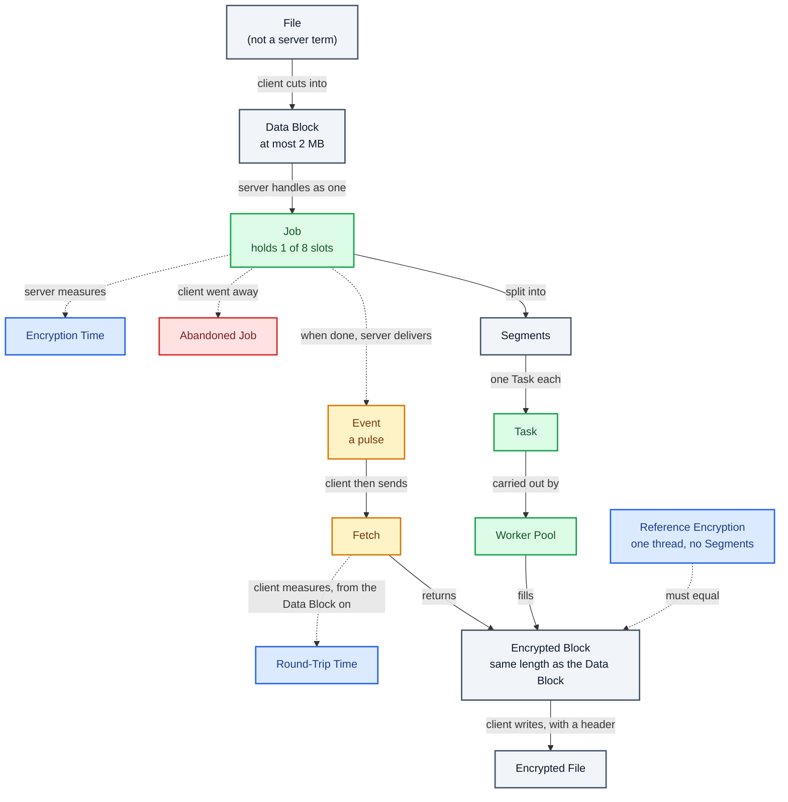

# Concurrent Encryption Service

A QNX server that receives a Data Block from a client, encrypts its Segments in parallel, and replies with the Encrypted Block. It exists to demonstrate safe, measurable concurrency on QNX.

How the terms below relate to each other (colours follow the sections: grey Data, green Processing, amber Notification, blue Verification and Measurement):

## Language

### Data

**Data Block**:
The bytes a client submits for encryption in one request, at most 2 MB. The server never sees files: the client sends a file as a sequence of Data Blocks.
_Avoid_: File, payload, message

**Encrypted Block**:
The bytes the server returns for one Data Block, the same length as the Data Block.
_Avoid_: Ciphertext buffer, output, result

**Encrypted File**:
What the client writes after encrypting a file: a short readable header, then the Encrypted Blocks of all the file's Data Blocks. The client can turn it back into the original file.
_Avoid_: Ciphertext file, output file, .enc

**Segment**:
A contiguous, independently encryptable slice of a Data Block. A Data Block of 64 KB or less is a single Segment.
_Avoid_: Chunk, part, piece

### Processing

**Job**:
The server's handling of one Data Block, from the moment it accepts the Data Block until the client fetches the Encrypted Block (or the Job is discarded). A Job holds one of a fixed number of slots for that whole time, so it also covers the wait between the Event and the Fetch. Several Jobs may be in progress at once.
_Avoid_: Request (that is the message, not the work), session, task

**Task**:
The unit of work that encrypts exactly one Segment of one Job.
_Avoid_: Job (a Job has many Tasks), work item

**Worker Pool**:
The fixed set of server threads that carry out Tasks from all Jobs.
_Avoid_: Thread pool (fine in code, but use Worker Pool when talking about the design)

**Abandoned Job**:
A Job whose client went away (it disconnected or died) before fetching the Encrypted Block. If its Tasks are still running, they finish and the Encrypted Block is discarded. If it had already finished, the server frees it at once. Either way its Job slot is released.
_Avoid_: Cancelled job (nothing is cancelled)

### Notification

**Event**:
The pulse that the client registers with the server and that the server delivers when a Job is done. It arrives on a private channel of the client's sender thread, and tells that thread to send the Fetch.
_Avoid_: Signal (a pulse is not a POSIX signal), callback, reply (the Event carries no data)

**Fetch**:
The second message for a Data Block, sent by the client after the Event. It names the Job, and the server answers it with the Encrypted Block. A Job can be fetched once, and only on the connection that sent the Data Block.
_Avoid_: Download, get result, poll

### Verification

**Reference Encryption**:
Encryption of a whole Data Block on a single thread, with no Segments, used to check that the Worker Pool produces identical bytes.
_Avoid_: Baseline, serial version

### Measurement

**Encryption Time**:
Server-side time for one Job from its first Task being queued to its last Task finishing.
_Avoid_: Processing time, server time

**Round-Trip Time**:
Client-side time from sending a Data Block to receiving its Encrypted Block. It spans the whole exchange: the Data Block message, the Event, and the Fetch.
_Avoid_: Latency, total time, end-to-end time
