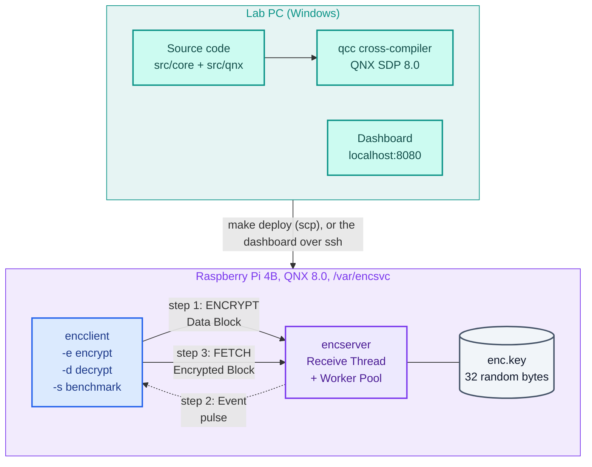
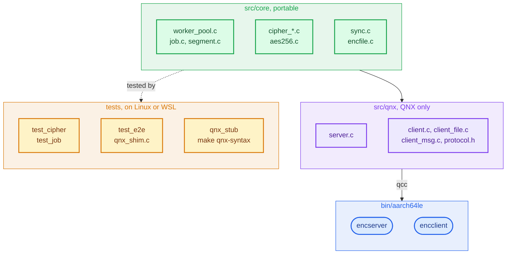

# Concurrent Encryption Service (QNX 8.0, Raspberry Pi 4B)

A client sends a Data Block of up to 2 MB to a QNX server. The server splits the block into Segments, encrypts them in parallel on a Worker Pool with AES-256-CTR, and tells the client with an event (a QNX pulse) when the Encrypted Block is ready, which the client then fetches. Any file of any size can be encrypted: the client sends it as several Data Blocks at once and writes an Encrypted File, which it can also decrypt again.

The code shows:
- mutex-protected shared output,
- condition-variable completion signalling,
- QNX message passing: `MsgSendv`, `MsgRead`, `MsgReplyv`, with the Data Block and the Encrypted Block moved through iov parts,
- asynchronous completion with a pulse: the client registers it (`MsgRegisterEvent`), the server delivers it (`MsgDeliverEvent`), and the client waits for it with `MsgReceivePulse`,
- a 10 s kernel timeout on the client (`TimerTimeout`), and disconnect and unblock pulses handled on the server.



**New to the project?** Start with [docs/BEGINNER-GUIDE.md](docs/BEGINNER-GUIDE.md): copy-paste steps from the lab PC to the Pi, and a checklist that tries every feature.

## Documents

| File | What it is |
|---|---|
| [docs/BEGINNER-GUIDE.md](docs/BEGINNER-GUIDE.md) | For first-time users: build, copy to the Pi, the demo, every feature as a checklist |
| [docs/DESIGN.md](docs/DESIGN.md) | Architecture, decisions, pseudocode, communication flow |
| [docs/LAB-GUIDE.md](docs/LAB-GUIDE.md) | Step by step: SD card, build, copy to the Pi, run, benchmark |
| [docs/adr/0001-deferred-reply.md](docs/adr/0001-deferred-reply.md) | Superseded by ADR 0003. Why the first version used a deferred reply |
| [docs/adr/0003-event-notification.md](docs/adr/0003-event-notification.md) | Why the server notifies the client with an event and the client then fetches the Encrypted Block (supersedes 0001) |
| [docs/adr/0002-encrypted-file-without-integrity-check.md](docs/adr/0002-encrypted-file-without-integrity-check.md) | Why Encrypted Files have no MAC and are decrypted on the client |
| [docs/VIVA-NOTES.md](docs/VIVA-NOTES.md) | Viva preparation: the rubric mapped to this repo, and likely questions with answers |
| [CONTEXT.md](CONTEXT.md) | Glossary: Data Block, Segment, Job, Task, Worker Pool, Event, Fetch… |
| [dashboard/README.md](dashboard/README.md) | The workflow dashboard: the ten steps, the console windows, settings |

## Layout

```
src/core/      portable: Worker Pool, Job, Segment planning, AES-256-CTR (POSIX only)
src/qnx/       QNX message passing: server.c (encserver), client.c + client_file.c + client_msg.c (encclient)
tests/         host tests, plus a message-passing stand-in for end-to-end tests
scripts/       demo.sh (guided demo), bench.sh (benchmark), lib.sh; all run on the Pi
examples/      real sample files for the demo: text, CSV, JSON, PDF, PNG, WAV
bin/aarch64le/ build output for the Pi
dashboard/     the workflow dashboard: runs every step on the Pi from this PC, shows the results
```

How the folders build into programs and tests:



## Dashboard

`dashboard\launch_dashboard.bat` opens a page at <http://localhost:8080> that takes you from
connecting to the Pi to the analytics in ten clicks: build, deploy, key, start encserver, encrypt
files, parallel Jobs, several clients, the scaling benchmark, clean up. The work shows in
command-prompt windows, as it would in SSH windows on the Pi (encclient's progress bars, the
encserver log, scp's transfer figures); the results and charts show on the page.
See [dashboard/README.md](dashboard/README.md): what to check before you start, a first run
click by click, what each button does, and what to do when a step fails.

```sh
py -m unittest discover -s dashboard/tests     # dashboard tests (no Pi needed)
```

## Build

```sh
# For the Pi (QNX SDP 8.0 environment loaded with qnxsdp-env.bat / qnxsdp-env.sh)
make                    # AES from OpenSSL libcrypto
make CRYPTO=builtin     # bundled AES instead, if OpenSSL is not available

# On Linux / WSL (gcc + libssl-dev)
make test               # all tests, with AddressSanitizer + UBSan
make tsan               # all tests, with ThreadSanitizer
make qnx-syntax         # compile-check the QNX sources against stub headers

# Copy everything to the Pi (default qnxuser@10.0.0.1:/var/encsvc)
make deploy             # or: make deploy PI=qnxuser@<ip> PI_DIR=<folder>
```

## Run (on the Pi)

```sh
cd /var/encsvc
dd if=/dev/urandom of=enc.key bs=32 count=1      # shared key, once
./encserver -v &                                 # -w N workers (default: CPU count), -v live log
./encclient -e examples/report.pdf               # -> report.pdf.enc  (readable header + encrypted bytes)
./encclient -d report.pdf.enc -o report2.pdf     # decrypt on the client; never overwrites a file
./encclient -s 2097152 -n 20                     # benchmark: 20 random 2 MB Data Blocks
./bench.sh                                       # 1/2/4/8 workers x 200 runs -> results.csv + speedup table
```

## Demo

Open two SSH windows on the Pi, both in `/var/encsvc`:

| Left window | Right window |
|---|---|
| `./encserver -v`: live log, one line per Job, with the Segments each worker encrypted | `./demo.sh`: steps 0 to 5, press Enter between steps |

The steps: check the set-up, a text file step by step, every example file in one table, a 12 MB file with 4 Data Blocks in flight, three clients at once, and Worker Pool scaling with speedup. `./demo.sh 3` runs one step; `./demo.sh -y` runs all without pausing. See [docs/LAB-GUIDE.md](docs/LAB-GUIDE.md), Part 7.

## Limits

These are set in `src/core/config.h`:

| Constant | Value | Meaning |
|---|---|---|
| `ENC_MAX_BLOCK` | 2 MB | Largest Data Block |
| `ENC_SINGLE_SEGMENT_MAX` | 64 KB | At or below this, a Data Block is one Segment |
| `ENC_MIN_SEGMENT` | 16 KB | Smallest Segment when splitting |
| `ENC_TASKS_PER_WORKER` | 4 | Segments per worker, for load balancing |
| `ENC_MAX_JOBS` | 8 | Jobs held at once, from accepting a Data Block until its Encrypted Block is fetched |
| `ENC_MAX_WAITING` | 64 | ENCRYPT requests waiting for a free Job slot (their clients stay blocked); beyond this the server answers `EBUSY` |
| `ENC_CLIENT_TIMEOUT_NS` | 10 s | A client gives up if its Encrypted Block has not arrived by then (`no Encrypted Block within 10 s`) |
| `ENC_MAX_WORKERS` | 64 | Largest Worker Pool (`-w`) |
