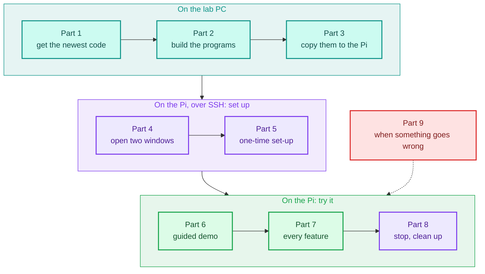
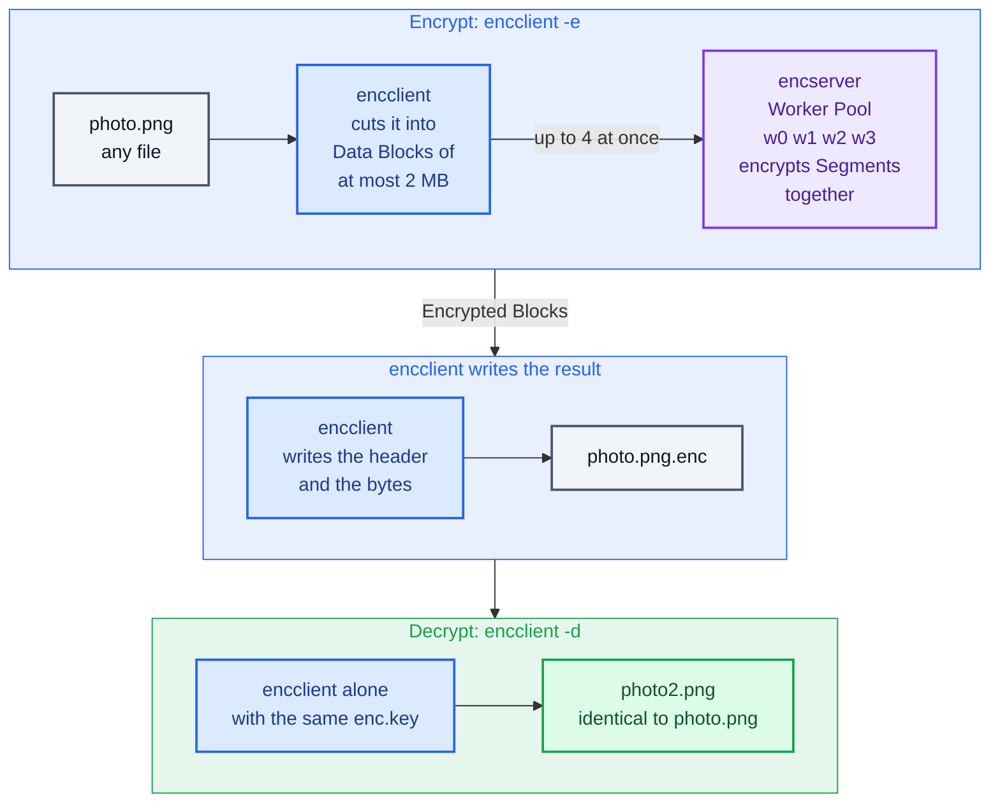
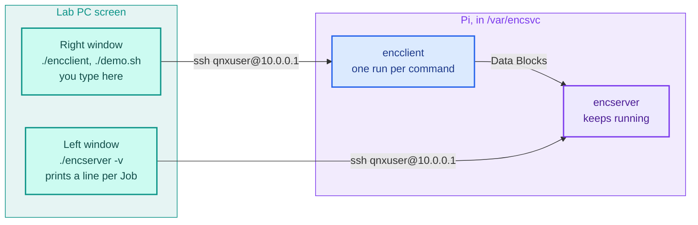
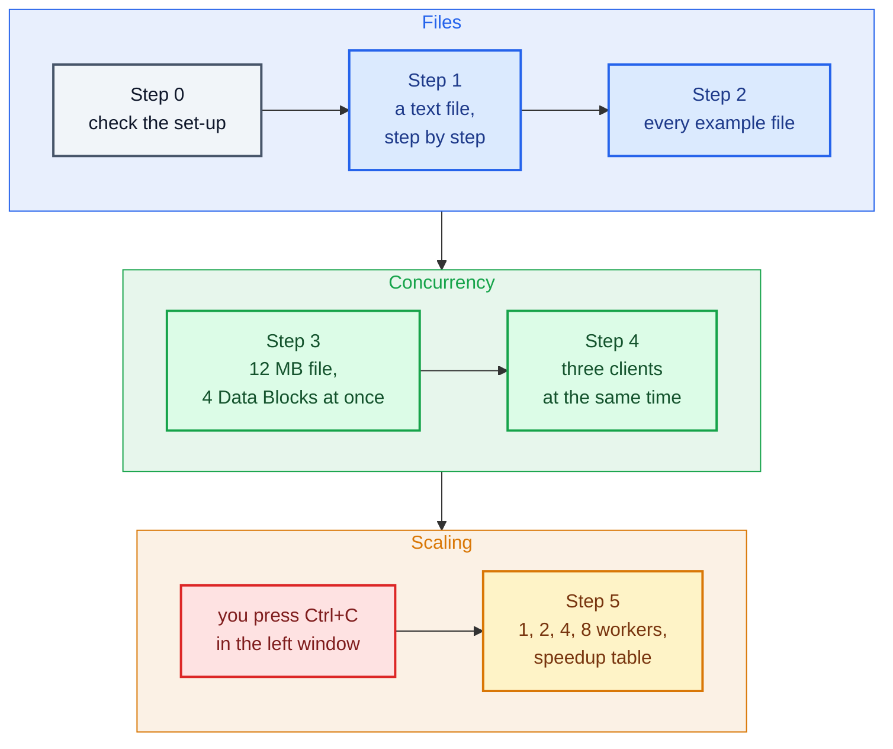
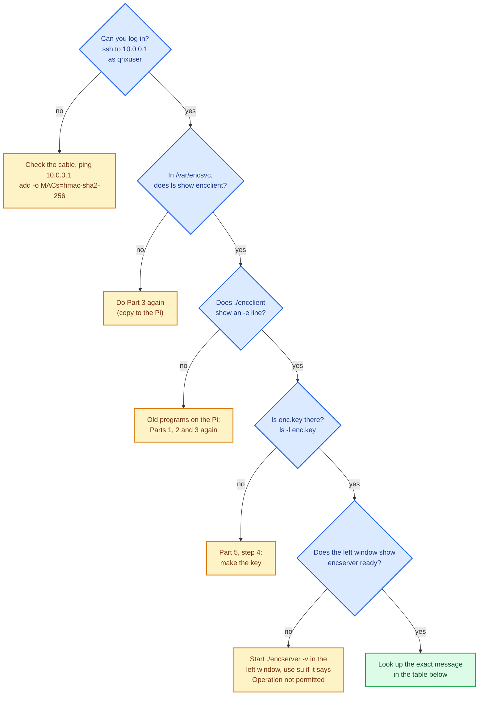

# Beginner's Guide: Run Every Feature on the Raspberry Pi

This guide is for you if you did not write this code. You need no C or QNX knowledge. Copy each command, press Enter, and compare what you get with the **You should see** notes.

- Parts 1 to 5 set everything up. Do them in order the first time.
- Part 6 is the guided demo. It shows most features in about five minutes.
- Part 7 is a checklist with **every** feature, one at a time.
- Part 9 helps when something goes wrong.



[LAB-GUIDE.md](LAB-GUIDE.md) has the deeper details (preparing the SD card, Momentics, Excel charts). You only need it if this guide sends you there.

**Prefer clicking?** `dashboard\launch_dashboard.bat` does Parts 2 to 8 for you from the PC, one button per step, and opens command-prompt windows that show the same output as the two Pi windows below. See [dashboard/README.md](../dashboard/README.md). This guide is still the way to learn what each command does.

---

## 1. What the project does

The life of one file, from `photo.png` to `photo.png.enc` and back:



The same picture as text:

```text
        encclient                                        encserver
   (you run it per file)                          (keeps running, waits for work)
 ┌──────────────────────────────┐                ┌──────────────────────────────┐
 │ photo.png (any file)         │  QNX message   │ cuts each Data Block into    │
 │  → cut into Data Blocks      │    passing     │ Segments; the Worker Pool    │
 │    of at most 2 MB           │ ─────────────► │ (4 threads on 4 cores)       │
 │  → sends up to 4 at once     │                │ encrypts them at the same    │
 │                              │ ◄───────────── │ time, then replies with the  │
 │ → saves photo.png.enc        │ Encrypted Block│ Encrypted Block              │
 └──────────────────────────────┘                └──────────────────────────────┘
      Decrypting (-d) is done by encclient alone, with the same key file.
```

- **encserver** is the server. Start it once and leave it running in its own window.
- **encclient** is the client. Run it once for each job: `-e` encrypts a file, `-d` decrypts it, `-s` measures speed.
- **enc.key** is the secret key, a file of 32 random bytes. The server and the client must use the same key file.
- The project is about **concurrency**: several threads work on one file at the same time, safely. More workers make it faster, up to 4, because the Pi has 4 cores.

Words you will see on the screen:

| Word | Meaning |
|---|---|
| Data Block | A piece of the file, at most 2 MB, sent to the server in one message |
| Segment | A smaller slice of a Data Block. Each worker encrypts whole Segments |
| Job | The server's work on one Data Block. `#12` in the server log is Job 12 |
| Worker, Worker Pool | The server's threads (`w0`, `w1`, `w2`, `w3`) that do the encrypting |
| Encrypted File | The `.enc` file: a short readable header, then the encrypted bytes |
| verified | The result was checked against a plain one-thread encryption, and it matched |

---

## 2. Terminal basics (read this once)

- You type commands into two kinds of windows. Every command box in this guide says which one:
  - **PC**: a Command Prompt on the lab PC. The prompt looks like `H:\Work\...>`.
  - **Pi**: an SSH window logged in to the Raspberry Pi. The prompt ends with `$`, or with `#` after `su`.
- Type or paste one line, then press **Enter**. When a box has several lines, run them one by one, top to bottom.
- To paste into a Command Prompt or SSH window, **right-click** inside it. Ctrl+V may not work there.
- **Ctrl+C** stops the program running in that window.
- When you type a password, nothing appears on the screen. That is normal: type it and press Enter.
- `..` means "the folder above". `.` means "this folder".

---

## Part 1: Get the newest code on the lab PC

The Pi must get the version with file encryption and the demo. The simple check is the `scripts` folder: it must contain **demo.sh**, **bench.sh** and **lib.sh**, and there must be an `examples` folder.

Our lab copy is in `H:\Work\Qnx_endsem\QNX-Concurrent-File-Encryption`. If yours is somewhere else, use that path instead, everywhere below. The path must have **no spaces** in it.

**If the folder is already there** (PC):

```bat
cd /d H:\Work\Qnx_endsem\QNX-Concurrent-File-Encryption
git checkout main
git pull
```

**If it is not there yet** (PC):

```bat
cd /d H:\Work\Qnx_endsem
git clone https://github.com/Sri-Krishna-V/QNX-Concurrent-File-Encryption.git
cd QNX-Concurrent-File-Encryption
```

No `git` on the PC? Open the GitHub page in a browser, click **Code → Download ZIP**, and unzip it into a folder without spaces in its path.

**Check you have the right version** (PC):

```bat
dir scripts examples
```

**You should see** `bench.sh`, `demo.sh` and `lib.sh`, and the example files `config.json`, `hello.txt`, `qnx-pi.png`, `report.pdf`, `sensor-log.csv` and `tone.wav`. If `demo.sh` is missing, you still have the old version: run `git pull` again.

---

## Part 2: Build the programs (PC)

1. Open **Command Prompt** (Start menu → type `cmd` → Enter) and load the QNX tools:

   ```bat
   %USERPROFILE%\qnx800\qnxsdp-env.bat
   ```

   If it says *not recognized*, the QNX SDP is installed somewhere else. Find `qnxsdp-env.bat` in File Explorer and run it with its full path. Keep this window open: in a new window you would have to run it again.

2. Build:

   ```bat
   cd /d H:\Work\Qnx_endsem\QNX-Concurrent-File-Encryption
   make clean
   make CRYPTO=builtin
   ```

   **You should see** two long lines that start with `qcc`, and no line with `error`. The programs are now in `bin\aarch64le\`: `encserver` and `encclient`.

   Always build with `CRYPTO=builtin` for the lab Pi. It puts the AES code inside the programs, because the Pi has no OpenSSL library.

---

## Part 3: Copy everything to the Pi (PC)

1. Check that the Pi is switched on and reachable:

   ```bat
   ping 10.0.0.1
   ```

   **You should see** `Reply from 10.0.0.1`. If you see `Request timed out`, check the Ethernet cable and the Pi's power, and wait one minute after power-on.

2. Copy the programs, scripts and example files, in the same window as Part 2:

   ```bat
   make deploy
   ```

   - The password is `qnxuser`. You type it up to **four** times, once for each copy step.
   - The first time, ssh asks `Are you sure you want to continue connecting?`. Type `yes` and press Enter.
   - **You should see** at the end: `deployed to qnxuser@10.0.0.1:/var/encsvc`.
   - Pi at another address? Use `make deploy PI=qnxuser@<address>`.

Do Part 2 and Part 3 again every time you get new code.

---

## Part 4: Open two windows on the Pi

Open **two new Command Prompt windows** (they do not need the QNX tools). Put them side by side: click a window and press **Windows key + ←**, then the other one and **Windows key + →**.

- **Left window = the server.**
- **Right window = the client**, where you type almost everything.



In **both** windows (Pi login, from the PC):

```bat
ssh -o MACs=hmac-sha2-256 qnxuser@10.0.0.1
```

Password `qnxuser`. Then, in **both** windows (Pi):

```sh
cd /var/encsvc
```

Every Pi command in this guide runs in `/var/encsvc`. If you get lost, type `cd /var/encsvc` again.

---

## Part 5: One-time set-up (right window, Pi)

1. Check that the files arrived:

   ```sh
   ls
   ```

   **You should see** `bench.sh  demo.sh  encclient  encserver  examples  lib.sh`.

2. Check that the Pi has the new programs:

   ```sh
   ./encclient
   ```

   **You should see** a help text that starts with `usage:` and then `encclient -e file [-o out.enc] ...`. If there is no `-e` line, the Pi still has old programs: go back to Part 2.

3. Stop any old server that may still be running from an earlier session. If it says it cannot find `encserver`, that is fine:

   ```sh
   slay encserver
   ```

4. Make the key file, **only once**:

   ```sh
   dd if=/dev/urandom of=enc.key bs=32 count=1
   ```

   **You should see** `1+0 records in` and `1+0 records out`. Don't make a new key later: files encrypted with the old key can't be decrypted with a new one (see 7.L).

---

## Part 6: The guided demo (most features in five minutes)

**Left window**, start the server with its live log:

```sh
./encserver -v
```

**You should see:**

```text
encserver ready
  name      /dev/name/local/encsvc
  workers   4
  cipher    AES-256-CTR, builtin backend, self-test passed
  limits    2.0 MB per Data Block, 8 Jobs at once

  JOB     CLIENT          SIZE   SEGMENTS         TIME   WORKERS (segments each)
```

The server now waits. Leave this window alone; it prints a line whenever work arrives.

> If you see `name_attach: Operation not permitted`, the server needs the root account. Type `su` (password `root`) in **both** windows, then `cd /var/encsvc` in both, and start `./encserver -v` again. From then on, use `su` in both windows every time.

**Right window**, start the demo:

```sh
./demo.sh
```

Press **Enter** to go to the next step. Watch both windows:



| Step | Right window (demo) | Left window (server) |
|---|---|---|
| 0 | Checks the key, the example files and the server | |
| 1 | Encrypts `hello.txt`, shows the header and the bytes before and after, decrypts it, says `✔ identical` | One Job: a `→ received` line, then a `✔` line. A small file is one Segment, so one worker does it |
| 2 | A table with every example file (text, CSV, JSON, PDF, PNG, WAV), each with `✔` in the SAME? column | One Job per file. Bigger files are split among `w0`–`w3` |
| 3 | A 12 MB file: 6 Data Blocks, 4 sent at once, then decrypted and compared | Several `→ received` lines before the first `✔`, with "2, 3, 4 Jobs in progress": the Jobs overlap |
| 4 | Three clients started at the same moment | Three different `pid` numbers mixed together |
| 5 | Asks you to **press Ctrl+C in the left window**. Then it runs its own servers with 1, 2, 4 and 8 workers and prints a speedup table | Nothing: you stopped this server |

In step 5, the SPEEDUP column should be about **2x** for 2 workers, about **3.5–4x** for 4, and about the same as 4 for 8 workers, because 8 workers still share 4 cores.

**You should see** at the end: `✔ Demo finished: every check passed.`

Afterwards, start the server again in the left window (`./encserver -v`) before Part 7.

Other ways to run the demo:

- `./demo.sh 3` runs only step 3. Any step from 0 to 5 works.
- `./demo.sh -y` runs all steps without waiting for Enter.
- The demo's files are in `/var/encsvc/demo-out`.

---

## Part 7: Try every feature (checklist)

The server runs in the left window (`./encserver -v`). Type these commands in the **right window**. Your times will be different from the examples: only the shape of the output matters.

### 7.A Encrypt a file

- [ ] Encrypt the short text file:

  ```sh
  ./encclient -e examples/hello.txt
  ```

  **You should see:**

  ```text
  encclient  encrypt  examples/hello.txt → hello.txt.enc
    input        hello.txt  397 B (397 bytes)
    Data Blocks  1 of up to 2.0 MB, 1 in flight at once
    progress     ██████████████████████████████  1/1 Data Blocks
    server       4 workers, 1 Segment in 1 Job, 0.168 ms encrypting
    wall time    1.746 ms  (222.0 KB/s)
    saved as     hello.txt.enc  522 B (125 B readable header + 397 B encrypted)
    status       ✔ encrypted
  ```

  In the **left window**, two lines for this Job:

  ```text
    #1    → pid 442        397 B  received, 1 Job in progress
    #1    ✔ pid 442        397 B          1     0.168 ms   w0 █ 1  w1 0  w2 0  w3 0
  ```

  `w0 █ 1` means worker 0 encrypted 1 Segment. The `.enc` file is saved in the folder you are in, named after the original file.

### 7.B Look inside an Encrypted File

- [ ] Show the readable header:

  ```sh
  head -n 6 hello.txt.enc
  ```

  **You should see** `QNX-ENC v1`, the original name, the size, the number of Data Blocks, one `iv` line per Data Block, and `---`. After `---` come the encrypted bytes, which look like random data.

### 7.C See the bytes before and after (`-x`)

- [ ] Encrypt again, with a preview of the first 16 bytes:

  ```sh
  ./encclient -e examples/hello.txt -x
  ```

  **You should see** two extra rows: `original` shows `Hello from QNX o`, and `encrypted` shows random-looking bytes. Encrypting again replaces the old `hello.txt.enc`.

### 7.D Decrypt and prove the file is identical

- [ ] Decrypt into a new file, then compare the two files byte by byte:

  ```sh
  ./encclient -d hello.txt.enc -o hello-copy.txt
  cmp examples/hello.txt hello-copy.txt && echo identical
  ```

  **You should see** `status ✔ decrypted`, then `identical`. The **left window shows nothing**, because decryption runs in the client alone, with the key file.

- [ ] Decrypt without `-o`: the client uses the original name from the header and saves `hello.txt` in this folder:

  ```sh
  ./encclient -d hello.txt.enc
  cat hello.txt
  ```

### 7.E Any kind of file: images, PDF, audio

- [ ] Encrypt and decrypt the picture, then compare:

  ```sh
  ./encclient -e examples/qnx-pi.png
  ./encclient -d qnx-pi.png.enc -o qnx-pi-copy.png
  cmp examples/qnx-pi.png qnx-pi-copy.png && echo identical
  ```

  Do the same with `report.pdf`, `tone.wav`, `sensor-log.csv` and `config.json` if you like. In the left window, bigger files use more workers: `sensor-log.csv` (182 KB) is split into 12 Segments, shared among `w0`–`w3`. How many each worker gets changes from run to run (for example `4 1 3 4`), because a worker that is free takes the next Segment.

- [ ] Open the decrypted picture on the PC. In a **PC** window, this copies it into your Downloads folder and opens it:

  ```bat
  cd /d %USERPROFILE%\Downloads
  scp -o MACs=hmac-sha2-256 qnxuser@10.0.0.1:/var/encsvc/qnx-pi-copy.png .
  start qnx-pi-copy.png
  ```

- [ ] Use your own file. Put it in the PC's Downloads folder, then copy it to the Pi (**PC** window; change `myphoto.jpg` to your file's name, preferably one without spaces):

  ```bat
  cd /d %USERPROFILE%\Downloads
  scp -o MACs=hmac-sha2-256 myphoto.jpg qnxuser@10.0.0.1:/var/encsvc/
  ```

  Then on the **Pi**:

  ```sh
  ./encclient -e myphoto.jpg
  ./encclient -d myphoto.jpg.enc -o myphoto-copy.jpg
  cmp myphoto.jpg myphoto-copy.jpg && echo identical
  ```

  The `-o` matters here: `myphoto.jpg` already exists in this folder, and decryption never overwrites a file.

### 7.F A big file: several Data Blocks at the same time

- [ ] Make a 12 MB file of random bytes and encrypt it:

  ```sh
  dd if=/dev/urandom of=big.bin bs=65536 count=192
  ./encclient -e big.bin
  ```

  **You should see** `Data Blocks  6 of up to 2.0 MB, 4 in flight at once`, a progress bar that fills up, and a `server` row such as `4 workers, 96 Segments in 6 Jobs`.

  In the **left window**, several Jobs arrive before the first one is done:

  ```text
    #3    → pid 458       2.0 MB  received, 1 Job in progress
    #4    → pid 458       2.0 MB  received, 2 Jobs in progress
    #5    → pid 458       2.0 MB  received, 3 Jobs in progress
    #6    → pid 458       2.0 MB  received, 4 Jobs in progress
    #3    ✔ pid 458       2.0 MB         16    35.488 ms   w0 ████ 4  w1 ████ 4  w2 ████ 4  w3 ████ 4
  ```

  This is concurrency: the server keeps accepting new Data Blocks while the workers are busy. The encrypting time in the `server` row is added up over the 6 Jobs, so it can be larger than the `wall time`: the Jobs overlapped.

- [ ] Send only one Data Block at a time with `-j 1` (you can choose 1 to 8; the default is 4):

  ```sh
  ./encclient -e big.bin -j 1 -o big-j1.enc
  ```

  In the left window it now says `1 Job in progress` every time: each Job finishes before the next one arrives.

- [ ] Decrypt and compare:

  ```sh
  ./encclient -d big.bin.enc -o big-copy.bin
  cmp big.bin big-copy.bin && echo identical
  ```

### 7.G Check every Data Block (`-V`)

- [ ] Encrypt with verification:

  ```sh
  ./encclient -e big.bin -V -o big-verified.enc
  ```

  **You should see** `status ✔ encrypted, every Data Block verified`. The client encrypted each Data Block again by itself, on one thread, and got exactly the same bytes as the server's 4 workers. This shows the workers share the output buffer safely.

### 7.H Several clients at the same time

- [ ] Start three clients together. `&` runs a command in the background, so all three start at once; `wait` waits until they have all finished:

  ```sh
  ./encclient -e big.bin -o client1.enc > client1.log &
  ./encclient -e examples/sensor-log.csv -o client2.enc > client2.log &
  ./encclient -s 2097152 -n 5 > client3.log &
  wait
  cat client1.log client2.log client3.log
  ```

  In the **left window**, Jobs from three different `pid` numbers are mixed together. Each `cat` part ends with an `OK` line (`status OK encrypted`, or `check OK run 1 verified`). The log files use plain `OK` and `#` instead of `✔` and `█`, because they are not a terminal.

### 7.I Measure the speed (benchmark mode)

- [ ] One random 2 MB Data Block:

  ```sh
  ./encclient -s 2097152
  ```

  **You should see:**

  ```text
  encclient  benchmark  2.0 MB random Data Block, 1 run
    sent         2.0 MB (2,097,152 bytes), waiting for the reply...
    main thread  free for 9 ticks of 5 ms while the server worked
    server       4 workers, 16 Segments
    encryption   40.456 ms on the server  (49.4 MB/s)
    round trip   51.985 ms on the client
    check        ✔ verified: same as the Reference Encryption, and decrypts back
  ```

  - `main thread free for 9 ticks`: the client's main thread was not stuck while it waited. A second thread sent the Data Block, waited for the server's event (a small message that says "your Job is done"), then fetched the Encrypted Block. The main thread was woken up when it arrived.
  - `encryption` is the time on the server. `round trip` also includes copying the 2 MB to the server and back, the event, and the fetch message, so it is always larger.

- [ ] Many runs, with warm-up runs that are not counted:

  ```sh
  ./encclient -s 2097152 -n 50 -W 5
  ```

  **You should see** `mean`, `min` and `max` for both times, and the speed in MB/s.

- [ ] Check every run, not only the first:

  ```sh
  ./encclient -s 2097152 -n 20 -V
  ```

  **You should see** `✔ all 20 runs verified`.

- [ ] Save one CSV row per run:

  ```sh
  ./encclient -s 2097152 -n 10 -c my-runs.csv
  cat my-runs.csv
  ```

  Each row is `workers,bytes,segments,run,encryption_us,round_trip_us,verified`, for example `4,2097152,16,1,38480.7,48383.7,pass`. Running it again adds more rows to the same file.

- [ ] A one-line summary, used by the scripts:

  ```sh
  ./encclient -s 2097152 -n 10 -S
  ```

  The numbers are: workers, bytes, runs, mean encryption µs, fastest encryption µs, mean round trip µs, fastest round trip µs.

- [ ] A small Data Block is not split:

  ```sh
  ./encclient -s 65536
  ```

  **You should see** `1 Segment`. Up to 64 KB, splitting would cost more time than it saves, so a single worker does it.

### 7.J Change the number of workers

- [ ] In the **left window**, press **Ctrl+C**, then start a server with 1 worker:

  ```sh
  ./encserver -w 1 -v
  ```

  In the **right window**:

  ```sh
  ./encclient -s 2097152 -n 20
  ```

  Note the `mean` encryption time. Repeat with `-w 2`, `-w 4` and `-w 8` in the left window. The time drops up to 4 workers and stays about the same at 8. The log shows one `w` column per worker.

- [ ] Go back to the normal server: Ctrl+C in the left window, then `./encserver -v`. Without `-w` it uses one worker per CPU core: 4 on the Pi.

### 7.K The full benchmark for the report (`bench.sh`)

- [ ] Stop the server in the **left window** with **Ctrl+C**. `bench.sh` starts and stops its own servers, and refuses to run while another one is running.

- [ ] In the **right window**:

  ```sh
  ./bench.sh
  ```

  This runs 200 measured runs of 2 MB for each of 1, 2, 4 and 8 workers, so it takes a few minutes. **You should see** a table with the columns `WORKERS`, `ENCRYPTION (mean)`, `ROUND TRIP (mean)`, `SPEEDUP` and `MB/s`, then `✔ done: one row per run in results.csv`.

  For a quick try first: `./bench.sh 2097152 20` (20 runs instead of 200).

- [ ] Copy the results into the PC's Downloads folder. In a **PC** window:

  ```bat
  cd /d %USERPROFILE%\Downloads
  scp -o MACs=hmac-sha2-256 qnxuser@10.0.0.1:/var/encsvc/results.csv .
  ```

  Make the chart in Excel as described in [LAB-GUIDE.md](LAB-GUIDE.md), Part 8, step 4.

- [ ] Start the server again in the left window: `./encserver -v`.

### 7.L Safety checks: these errors are supposed to happen

Each command below must **fail** with the message shown. That is the feature: the program protects your files and tells you what is wrong.

| Try this (right window) | You should see | Why |
|---|---|---|
| `./encclient -d hello.txt.enc -o hello-copy.txt` (a second time) | `hello-copy.txt already exists; delete it or choose another name with -o` | Decryption never overwrites a file |
| `./encclient -d examples/hello.txt` | `examples/hello.txt is not an Encrypted File (it must start with "QNX-ENC v1")` | Only `.enc` files can be decrypted |
| `dd if=big.bin.enc of=cut.enc bs=1000 count=1`, then `./encclient -d cut.enc -o x.bin` | `cut.enc is damaged: the header promises 12,582,912 encrypted bytes, the file has 667` | A file cut short (for example by an interrupted copy) is detected before anything is written |
| `./encclient -s 3000000` | `-s 3000000 exceeds the limit of 2097152 bytes` | A Data Block is at most 2 MB |
| `./encclient -e examples` | `examples is not a regular file` | Only files can be encrypted, not folders |
| `./encserver` (while the left one runs) | `name_attach: File exists`, then `another encserver is already running (slay encserver)` | Only one server can own the name `encsvc` |
| Ctrl+C in the left window, then `./encclient -e examples/hello.txt` | `cannot reach "encsvc": … Is encserver running?` | The client needs the server to encrypt. Start `./encserver -v` again afterwards |

- [ ] **A wrong key is not detected.** This is a known limit of the design ([ADR 0002](adr/0002-encrypted-file-without-integrity-check.md)): the file has no integrity check, so a wrong key gives wrong bytes without an error.

  ```sh
  dd if=/dev/urandom of=other.key bs=32 count=1
  ./encclient -d hello.txt.enc -k other.key -o wrong.txt
  cmp examples/hello.txt wrong.txt
  ```

  **You should see** `status ✔ decrypted`, but then `cmp` says the files `differ`. `-k` chooses a different key file; both `encclient` and `encserver` accept it.

### 7.M Display options

- [ ] If you see odd characters instead of `✔ █ →`, use plain ASCII symbols. Run this in **both** windows, then restart the server:

  ```sh
  export ENC_ASCII=1
  ```

- [ ] Turn colours off with `export NO_COLOR=1`. This also switches to the plain ASCII symbols. Undo both with `unset ENC_ASCII NO_COLOR`.

---

## Part 8: Stop and clean up

- **Stop the server:** Ctrl+C in the left window. If that window is gone, run `slay encserver` in any Pi window.
- **Delete the files you made** (right window, in `/var/encsvc`). Copy `results.csv` to the PC first if you need it:

  ```sh
  rm -rf demo-out
  rm -f *.enc *.log *.csv *.bin *-copy.* hello.txt wrong.txt other.key
  ls
  ```

  **You should see** only `bench.sh  demo.sh  enc.key  encclient  encserver  examples  lib.sh` (plus any file of your own you copied in). Keep `enc.key`.
- **Log out** of the Pi: `exit` (twice if you used `su`).

---

## Part 9: When something goes wrong

Start at the top and follow the first answer that fits. The table below has the exact messages.



| What you see | What to do |
|---|---|
| `demo.sh: not found`, or `./encclient` shows no `-e` line | The Pi has the old version. Do Part 1, Part 2 and Part 3 again |
| `Permission denied` when starting a program or script | `chmod +x encserver encclient demo.sh bench.sh` |
| `cannot load key file enc.key` | You are not in `/var/encsvc` (type `cd /var/encsvc`), or you skipped Part 5, step 4 |
| `cannot reach "encsvc"` … `Is encserver running?` | Start `./encserver -v` in the left window first |
| `another encserver is already running` | `slay encserver`, then start it again |
| `name_attach: Operation not permitted` | Use `su` (password `root`) in **both** windows; see Part 6 |
| The demo keeps printing `waiting for encserver....` | Start `./encserver -v` in the left window, in `/var/encsvc` |
| `no Encrypted Block within 10 s` (after `request failed:` or `Data Block N failed:`) | The client waited 10 s and gave up. Look at the left window: the server may have stopped (start it again), or it is overloaded (many clients at once). Run the command again |
| `Encrypted Block differs from the Reference Encryption` | The server and the client use different keys. Stop the server and start it again in `/var/encsvc` |
| A decrypted file differs from the original, with no error | It was encrypted with a different `enc.key` (someone made a new key). Encrypt the original again |
| On the Pi: `Could not load library libcrypto.so.3` | The build missed `CRYPTO=builtin`. Do Part 2 again (with `make clean`), then Part 3 |
| `qcc: command not found` or `make: command not found` on the PC | Run `qnxsdp-env.bat` in that window first (Part 2, step 1) |
| ssh: `no matching MAC found` | Add `-o MACs=hmac-sha2-256`, exactly as in Part 4 |
| ssh: `REMOTE HOST IDENTIFICATION HAS CHANGED` | The Pi's SD card was rewritten. On the PC: `ssh-keygen -R 10.0.0.1`, then log in again |
| ssh: `Connection timed out` | The Pi is off, still booting, or not on the network. Check the cable and run `ping 10.0.0.1` |
| `bad interpreter` or `$'\r': command not found` | A script got Windows line endings. See the fix in [LAB-GUIDE.md](LAB-GUIDE.md), Part 9 |
| Odd characters instead of `✔ █ →` | `export ENC_ASCII=1` in both windows (7.M) |

Anything else: see the full table in [LAB-GUIDE.md](LAB-GUIDE.md), Part 9. When you ask for help, copy the whole output and the command you typed.

---

## Showing the project (five minutes)

1. Left window `./encserver -v`, right window `./demo.sh`.
2. Point at what each part of the design does:

   | What you show | What it proves | Where it is explained |
   |---|---|---|
   | Step 1 or 2: the `w0 … w3` columns in the server log | The Worker Pool splits a Data Block into Segments and encrypts them in parallel | [DESIGN.md](DESIGN.md) 4.1–4.3 |
   | `verified` / `identical` (7.G, 7.D) | Workers write into one shared output buffer safely (mutex) | [DESIGN.md](DESIGN.md) 4.4 |
   | `✔` appears only after all Segments are done; `main thread free for … ticks` (7.I) | Completion is signalled with a condition variable | [DESIGN.md](DESIGN.md) 4.5 |
   | Step 3 or 4: several Jobs `in progress` at once | The server answers ENCRYPT at once, tells the client with an event (pulse) when the Job is done, and the client fetches the result, so the server keeps accepting new messages | [DESIGN.md](DESIGN.md) 4.6, [ADR 0003](adr/0003-event-notification.md) |
   | Step 5, or `bench.sh` | Speedup grows up to 4 workers on 4 cores | [DESIGN.md](DESIGN.md) 7 |

**With the dashboard instead:** the *encserver on the Pi* window is the left window, and the
*Dashboard activity* window is the right one. Run steps 1 to 9 (see the click-by-click run in
[dashboard/README.md](../dashboard/README.md)), point at the same things in the two windows, and
finish on the **Analytics** tab: the speedup chart (step 9), Segments per worker (load balance),
and the Round-Trip Time of several clients (step 8).

---

## Cheat sheet

```sh
# --- once (Pi, right window)
cd /var/encsvc
dd if=/dev/urandom of=enc.key bs=32 count=1

# --- server (Pi, left window); Ctrl+C stops it
./encserver -v                 # live log, 4 workers
./encserver -w 2 -v            # choose the number of workers (1 to 64)

# --- files (Pi, right window)
./encclient -e FILE            # encrypt  -> FILE.enc in this folder
./encclient -e FILE -x         #   ... and show the first bytes before and after
./encclient -e FILE -V         #   ... and check every Data Block
./encclient -e FILE -j 1       #   ... one Data Block at a time (1 to 8, default 4)
./encclient -e FILE -o NAME    #   ... choose the output name
./encclient -d FILE.enc        # decrypt  -> original name (never overwrites)
./encclient -d FILE.enc -o NAME
cmp ORIGINAL COPY && echo identical
head -n 6 FILE.enc             # the readable header

# --- speed (Pi, right window)
./encclient -s 2097152                    # one 2 MB Data Block
./encclient -s 2097152 -n 50 -W 5 -V      # 50 runs after 5 warm-ups, all checked
./encclient -s 2097152 -n 20 -c runs.csv  # one CSV row per run
./bench.sh                                # full benchmark (stop your server first)
./bench.sh 2097152 20                     # quick version

# --- demo (Pi, right window; server running in the left one)
./demo.sh        # all steps, Enter between steps
./demo.sh 3      # only step 3
./demo.sh -y     # no pauses

# --- other
slay encserver   # stop a server you can't reach with Ctrl+C
# add  -k other.key  to encclient or encserver to use another key file
```

On the PC:

```bat
%USERPROFILE%\qnx800\qnxsdp-env.bat
cd /d H:\Work\Qnx_endsem\QNX-Concurrent-File-Encryption
git pull
make clean
make CRYPTO=builtin
make deploy
ssh -o MACs=hmac-sha2-256 qnxuser@10.0.0.1
```
