# Concurrent Encryption Service on QNX: Design

A client sends a **Data Block** (up to 2 MB) to a QNX server. The server encrypts the block's **Segments** in parallel on a **Worker Pool**, uses a mutex to protect the shared output, signals completion with a condition variable, and tells the client with an **Event** (a QNX pulse) when the **Encrypted Block** is ready. The client then fetches it. The terms in bold are defined in [`CONTEXT.md`](../CONTEXT.md).

To encrypt a whole file, the client cuts it into Data Blocks, sends several at once, and writes an **Encrypted File**: a readable header followed by the encrypted bytes. Section 8 covers files.

- Target: QNX SDP 8.0.3 on a Raspberry Pi 4B (4 × Cortex-A72, no AES hardware instructions).
- Cipher: AES-256-CTR.

The diagrams use the same colours throughout: **blue** for the client, **purple** for the server's Receive Thread, **amber** for the Job Coordinator, **green** for the Worker Pool, **rose** for the QNX kernel, and **grey** for data.

---

## 1. Architecture

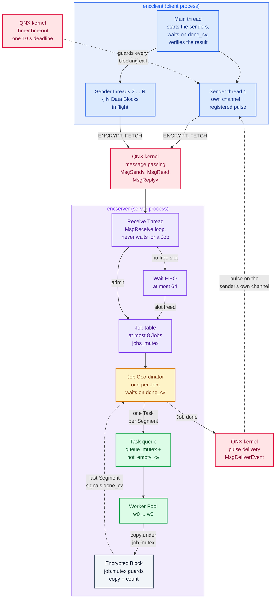

<details>
<summary>Plain-text version of this diagram</summary>

```
 CLIENT PROCESS (encclient)                   SERVER PROCESS (encserver)
┌───────────────────────────┐        ┌────────────────────────────────────────────────┐
│ Main thread               │        │ Receive Thread  (MsgReceive loop, never waits) │
│  ├─ starts sender thread  │        │   ├─ ENCRYPT: MsgRead the Data Block, reply    │
│  ├─ stays free            │        │   │    with a Job id, start a Job Coordinator  │
│  └─ woken by done_cv      │        │   ├─ no free slot: request waits in a FIFO     │
│                           │        │   ├─ FETCH: MsgReplyv the Encrypted Block      │
│ Sender thread             │        │   └─ disconnect and unblock pulses             │
│  ├─ 1 ENCRYPT ────────────┼───────►│                                                │
│  ├─ 2 MsgReceivePulse  ◄──┼─ Event ┼─ Job Coordinator (one per Job)                 │
│  │    own channel,        │        │     ├─ splits Data Block into Segments         │
│  │    TimerTimeout        │        │     ├─ queues one Task per Segment ─────┐      │
│  └─ 3 FETCH ──────────────┼───────►│     ├─ waits on job.done_cv ◄── signal ─┼┐     │
│                           │        │     └─ MsgDeliverEvent (after the wait) ││     │
│ verifies the result       │        │ Worker Pool  (-w N, default = CPUs)     ││     │
└───────────────────────────┘        │   queue [queue_mutex + not_empty_cv] ◄──┘│     │
                                     │   worker: encrypt into private buffer,   │     │
                                     │     lock job.mutex, copy into output,    │     │
                                     │     count++, last one signals ───────────┘     │
                                     └────────────────────────────────────────────────┘
```

</details>

| Component | Responsibility | Code |
|---|---|---|
| Receive Thread | Owns the channel. Handles ENCRYPT, FETCH and the disconnect and unblock pulses. Holds at most `ENC_MAX_JOBS` Jobs, queues the rest, and never waits for a Job. | `src/qnx/server.c` `receive_loop`, `handle_encrypt`, `handle_fetch` |
| Job Coordinator | Runs one Job, then delivers the client's Event. | `src/qnx/server.c` `job_coordinator`, `finish_job`; `src/core/job.c` `job_run` |
| Worker Pool | A fixed set of threads that take Tasks from one shared FIFO queue. | `src/core/worker_pool.c` |
| Task | Encrypts one Segment, then commits it under the Job mutex. | `src/core/job.c` `encrypt_segment`, `commit_segment` |
| Segment planning | Decides the Segment size for a Data Block. | `src/core/segment.c` |
| Cipher | AES-256-CTR that can start at any block-aligned offset. | `src/core/cipher_*.c` |
| Client protocol | Registers the Event, sends ENCRYPT, waits for the pulse, sends FETCH, enforces the 10 s deadline. | `src/qnx/client_msg.c` `encsvc_encrypt` |
| Client | Runs sender threads, verifies the result, and reports times. | `src/qnx/client.c`, `src/qnx/client_file.c` |
| Checked locking | Wrappers that check every pthread call and abort on a programming error. | `src/core/sync.c`, `src/core/sync.h` |

---

## 2. Key decisions

| # | Decision | Reason |
|---|---|---|
| 1 | **Event, then fetch**: ENCRYPT is answered at once with a Job id. When the Job is done, the Job Coordinator calls `MsgDeliverEvent` with the pulse the client registered, and the client then sends FETCH to get the Encrypted Block. | The brief asks for an asynchronous return through an event. The client blocks only its sender thread, and the server stays responsive. See [ADR 0003](adr/0003-event-notification.md), which supersedes [ADR 0001](adr/0001-deferred-reply.md). |
| 2 | **Large messages**: the client sends `[header, Data Block]` as two iov parts. The server receives only the header, then pulls the Data Block with `MsgRead` at offset `sizeof(header)`. FETCH is answered with `MsgReplyv([result header, Encrypted Block])`. | No receive buffer has to be as large as the Data Block, and no extra copy is made into one contiguous reply buffer. |
| 3 | **AES-256-CTR**, with each Segment starting at counter `IV + offset/16`. | CTR has no chaining between blocks, so Segments are independent and can run in parallel. The output is the same length as the input. |
| 4 | **New random IV for every Job**, returned in the FETCH reply. | Reusing an IV with the same key in CTR mode exposes the data. |
| 5 | **Shared key file** that the client and server both load at start-up (`enc.key`, 32 bytes). | The client needs the key to verify. Key handling stays out of the protocol. |
| 6 | **Workers encrypt into private memory** and take `job.mutex` only to copy into the output and update the counter. | The critical section is one `memcpy`, so workers rarely wait on each other. |
| 7 | **Predicate wait**: `while completed < total: wait(done_cv)`. | Handles spurious wake-ups, and the case where the last worker finishes before the Coordinator waits. |
| 8 | **At most 8 Jobs** (`ENC_MAX_JOBS`). A Job holds a slot from ENCRYPT until FETCH. Further ENCRYPT requests wait in a FIFO of at most 64 (`ENC_MAX_WAITING`), reply-blocked, and get `EBUSY` beyond that. The Receive Thread never stops receiving. | The server stores results until they are fetched, so memory must be bounded: at most about 32 MB (8 Jobs × Data Block + Encrypted Block). The Receive Thread must stay free to receive the FETCH that frees a slot, or the server would deadlock. A waiting request costs only a small record, because its data stays in the client's buffer. |
| 9 | **Abandoned Job**: the channel's disconnect pulse tells the server that a client has gone. It drops that client's waiting requests and finished Jobs at once, and marks running Jobs Abandoned, so their Coordinators free them when they finish. | Nothing leaks when a client dies, and no Job slot stays taken. Cancelling running Tasks is not needed: they finish in milliseconds and the result is discarded. |
| 10 | **Size rules**: a Data Block of 0 bytes is rejected (`EINVAL`), more than 2 MB is rejected (`EMSGSIZE`), and 64 KB or less is one Segment. | A Job with zero Segments would never signal completion. Splitting tiny blocks only adds overhead. |
| 11 | **One 10 s deadline** (`ENC_CLIENT_TIMEOUT_NS`) for the whole ENCRYPT, event, FETCH exchange. `TimerTimeout` is armed before each blocking call, with the time that is left. | A stopped or overloaded server must not hang the client. `TimerTimeout` applies only to the next blocking call, so it is re-armed each time. |
| 12 | **The client's Event is a pulse to its own private channel**, one channel per sender thread, registered with `MsgRegisterEvent`. The connection to that channel is made with `ConnectAttach` and `_NTO_SIDE_CHANNEL`. The server is reached only through `name_open`. | A pulse needs a connection to travel on, and only the client can create one to its own channel. Registering it (QNX secure events) replaces the event with a handle that only this server may deliver; QNX 8.0 accepts only registered events by default. The server never builds or changes an Event. Each sender thread then receives only its own pulses. |
| 13 | **A Job is tied to the client** (its `scoid`, which QNX gives per client process): FETCH must come from the client that sent ENCRYPT, or the answer is `ENOENT`. | One client cannot fetch, or discard, another client's Encrypted Block. |
| 14 | **Every API return value is checked.** `src/core/sync.h` wraps the pthread calls that fail only through a programming error (`enc_lock`, `enc_cond_wait`, …): they print the failing call and abort. Calls that can fail for ordinary reasons (`pthread_create`, initialisation) are checked by their callers. Only plain terminal printing is left unchecked. | A locking bug stops the program at the failing call instead of corrupting data later. |

### Segment size

```
if len ≤ 64 KB:           one Segment of len bytes
else:
    target   = ceil(len / (workers × 4))     // 4 Tasks per worker balances the load
    seg_size = round_up(max(16 KB, target), 16)
```

A 2 MB Data Block on 4 workers gives 16 Segments of 128 KB.

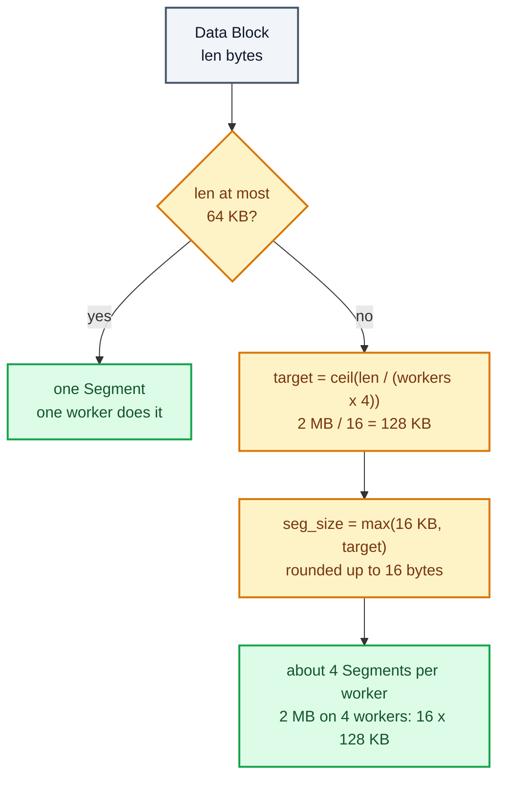

---

## 3. Data structures

```
STRUCT Task                         // one per Segment; queued on the Worker Pool
    job, offset, length

STRUCT Job                          // the cipher work (src/core/job.h)
    key, iv, input, len, total_segments      // read-only while the Job runs
    output, completed_count, error           // shared: guarded by mutex
    finish_time                              // set by the worker that completes the last Segment
    worker_segments[]                        // Segments done by each worker, for the server log
    mutex, done_cv

STRUCT WorkerPool
    threads[N]
    queue (FIFO of Task), shutdown           // guarded by queue_mutex
    queue_mutex, not_empty_cv

STRUCT ServerJob                    // the server's record of one Job (src/qnx/server.c)
    job (a Job), id                          // the client quotes id in FETCH
    scoid, rcvid, client_pid                 // the client's connection, and its ENCRYPT message
    event                                    // the client's registered pulse
    done, abandoned, err, next               // guarded by jobs_mutex

STRUCT Waiting                      // an ENCRYPT request that has no Job slot yet
    rcvid, scoid, client_pid, request, next  // FIFO, guarded by jobs_mutex

SERVER STATE (guarded by jobs_mutex)
    jobs               // ServerJobs: running, or done and not yet fetched
    held               // Job slots in use, at most ENC_MAX_JOBS
    wait queue         // FIFO of Waiting, at most ENC_MAX_WAITING

STRUCT Notify                       // one per client sender thread (src/qnx/client.h)
    chid, self_coid                 // private channel, and the connection the pulse travels on
    event                           // the registered pulse, sent with every ENCRYPT
```

The same structures, with who owns what and which lock guards it:

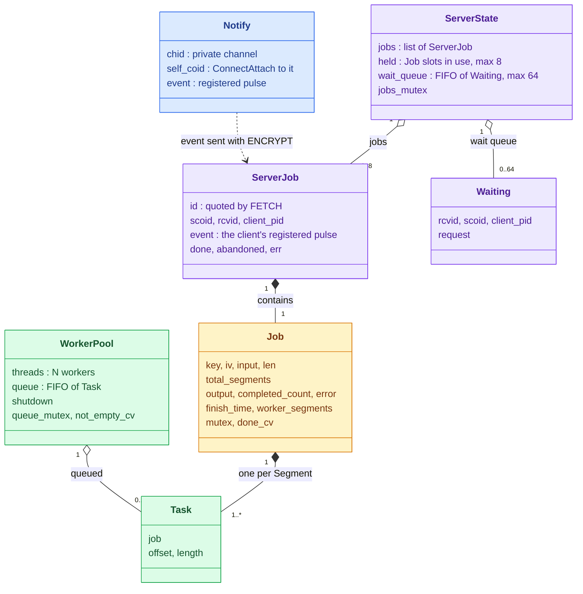

---

## 4. Pseudocode

The path of one Job through 4.1 to 4.5, at a glance. Only two locks are involved: `queue_mutex` to take a Task, and `job.mutex` to hand the result back. The encryption itself runs with no lock held.

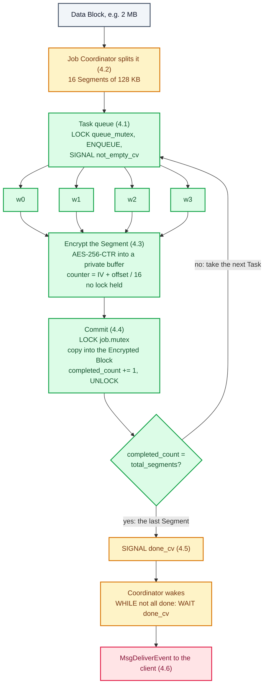

### 4.1 Worker Pool creation

```
FUNCTION pool_create(n)
    pool.queue <- empty; pool.shutdown <- false
    INIT queue_mutex, not_empty_cv
    REPEAT n TIMES: START THREAD worker_loop(pool)

FUNCTION pool_submit(pool, task)
    LOCK queue_mutex
        ENQUEUE task
        SIGNAL not_empty_cv
    UNLOCK queue_mutex

FUNCTION worker_loop(pool)
    LOOP
        LOCK queue_mutex
            WHILE queue empty AND NOT shutdown: WAIT(not_empty_cv, queue_mutex)
            IF queue empty: UNLOCK; EXIT THREAD          // shutdown and drained
            task <- DEQUEUE
        UNLOCK queue_mutex
        encrypt_segment(task)                            // no pool lock held

FUNCTION pool_destroy(pool)
    LOCK queue_mutex; shutdown <- true; BROADCAST not_empty_cv; UNLOCK
    JOIN all threads
```

### 4.2 Segment division

```
FUNCTION split(job, workers)
    seg <- segment_size_for(job.len, workers)            // see "Segment size" above
    FOR offset FROM 0 TO job.len STEP seg
        ADD Task{ job, offset, MIN(seg, job.len - offset) }
    job.total_segments <- number of Tasks                // set before any submit
```

### 4.3 Encryption of each Segment

```
FUNCTION encrypt_segment(task)
    scratch <- ALLOCATE(task.length)                     // private to this worker
    status  <- AES256_CTR(key, counter = job.iv + task.offset / 16,
                          job.input[task.offset ..], scratch)
    commit_segment(task, scratch, status)
```

### 4.4 Mutex protection of the output buffer

```
FUNCTION commit_segment(task, scratch, status)
    LOCK job.mutex
        IF status OK: COPY scratch -> job.output[task.offset ..]
        ELSE IF job.error unset: job.error <- status
        job.completed_count += 1                         // counted even on failure
        IF job.completed_count = job.total_segments
            job.finish_time <- NOW
            SIGNAL job.done_cv
    UNLOCK job.mutex
```

### 4.5 Condition-variable signalling when all Tasks finish

```
FUNCTION job_run(job, pool)                              // Job Coordinator thread
    split(job, pool.size)
    start <- NOW
    FOR EACH task: pool_submit(pool, task)
    LOCK job.mutex
        WHILE job.completed_count < job.total_segments: WAIT(job.done_cv, job.mutex)
        job.encryption_time <- job.finish_time - start
    UNLOCK job.mutex
    RETURN job.error
```

### 4.6 Asynchronous return of the Encrypted Block: ENCRYPT, event, FETCH

All server state below (`jobs`, `held`, the wait queue, each ServerJob's `done` and `abandoned`) is guarded by `jobs_mutex`.

The life of one ENCRYPT request on the server. Every state from Running until Slot freed, Abandoned included, holds one of the 8 Job slots:

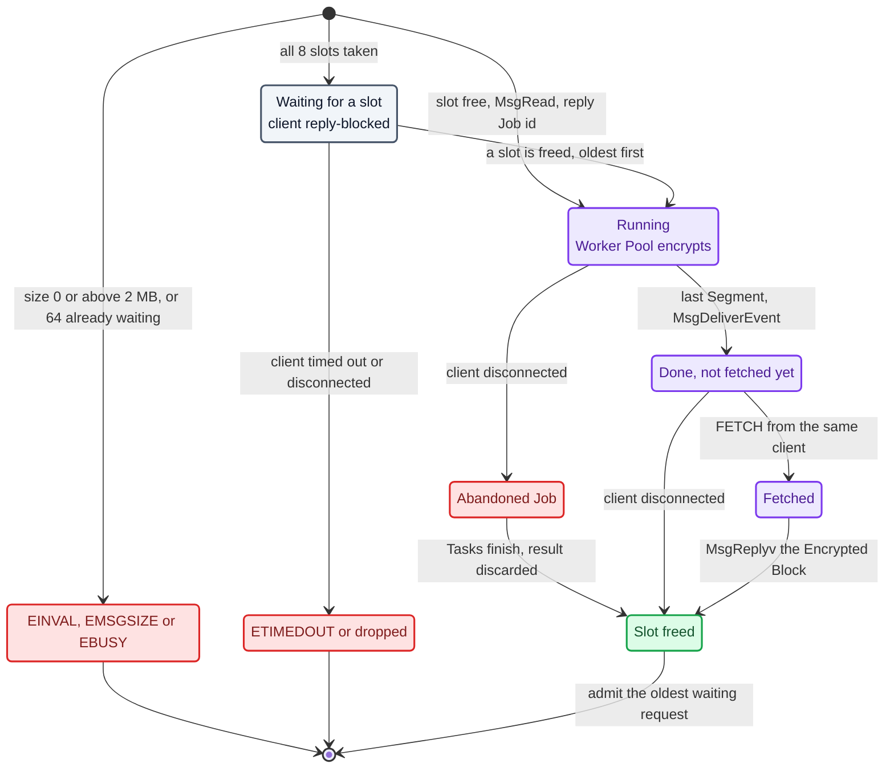

```
// Server: Receive Thread. Never waits for a Job.
LOOP
    rcvid, msg <- MsgReceive(chid)
    IF rcvid = 0 (a pulse):
        CASE code OF
            DISCONNECT: handle_disconnect(pulse.scoid)
            UNBLOCK:    handle_unblock(pulse.value)
    ELSE CASE msg.type OF
        connect:  MsgReply(rcvid, OK)                    // sent by name_open
        ENCRYPT:  handle_encrypt(rcvid, msg)
        FETCH:    handle_fetch(rcvid, msg)
        other:    MsgError(rcvid, ENOSYS)

FUNCTION handle_encrypt(rcvid, req)
    IF req.data_len = 0 OR > 2 MB: MsgError(rcvid, EINVAL or EMSGSIZE); RETURN
    LOCK jobs_mutex
        IF held < 8 AND wait queue empty:   held += 1; start_now <- true
        ELSE IF waiting < 64:               APPEND request to wait queue   // client stays reply-blocked
        ELSE:                               reject <- true
    UNLOCK jobs_mutex
    IF start_now: admit(request)
    IF reject:    MsgError(rcvid, EBUSY)

FUNCTION admit(request)                                  // a Job slot is already reserved
    job.input <- MsgRead(rcvid, data_len, offset = sizeof header)
    job.iv    <- RANDOM 16 bytes
    ADD ServerJob{ id, scoid, rcvid, req.event } to jobs
    MsgReply(rcvid, { job id })                          // the early answer: the client unblocks
    START DETACHED THREAD job_coordinator(job)
    // any failure before the MsgReply: MsgError(rcvid), release the slot

// Server: Job Coordinator, one per Job
err <- job_run(job, pool)                                // 4.5
LOCK jobs_mutex
    job.done <- true; job.err <- err
    gone <- job.abandoned OR MsgDeliverEvent(rcvid, client's event) fails
    IF gone: REMOVE job from jobs
UNLOCK jobs_mutex
IF gone: FREE job; admit_waiting()                       // Abandoned Job: result discarded

FUNCTION handle_fetch(rcvid, req)
    LOCK jobs_mutex
        job <- FIND(req.job_id, this client's scoid)
        IF none: err <- ENOENT                           // unknown Job, or another client's
        ELSE IF NOT job.done: err <- EAGAIN
        ELSE REMOVE job from jobs                        // ours now
    UNLOCK jobs_mutex
    IF err: MsgError(rcvid, err); RETURN
    IF job.err: MsgError(rcvid, job.err)
    ELSE MsgReplyv(rcvid, [result_header{len, segments, iv, encryption_time, workers},
                           job.output])
    FREE job; admit_waiting()                            // the slot is free again

FUNCTION admit_waiting()
    WHILE held < 8 AND wait queue not empty (oldest first):
        held += 1; request <- DEQUEUE; admit(request)

FUNCTION handle_disconnect(scoid)                        // client closed its connection or died
    LOCK jobs_mutex
        REMOVE this client's requests from the wait queue
        FOR EACH job of this client:
            IF job.done: REMOVE it, held -= 1, free it   // finished, never fetched
            ELSE:        job.abandoned <- true           // its Coordinator frees it
    UNLOCK jobs_mutex
    ConnectDetach(scoid); admit_waiting()

FUNCTION handle_unblock(rcvid)                           // the client's TimerTimeout expired
    IF a waiting request has this rcvid: REMOVE it; MsgError(rcvid, ETIMEDOUT)
    // otherwise it is being answered right now, which unblocks the client anyway
```

```
// Client: one sender thread per request or Data Block in flight
Notify (once per thread):
    chid  <- ChannelCreate()
    self  <- ConnectAttach(own chid, _NTO_SIDE_CHANNEL)   // the pulse travels on this connection
    event <- pulse(self, code DONE, value chid)
    MsgRegisterEvent(event, server_coid)                  // the server may now deliver it

FUNCTION encsvc_encrypt(coid, notify, data)
    deadline <- NOW + 10 s                                // one deadline for all three steps
    // 1. ENCRYPT
    TimerTimeout(SEND|REPLY, deadline - NOW)
    MsgSendv(coid, [ENCRYPT header + event | data], [accepted])    // returns at once with the Job id
    LOOP
        // 2. wait for the Event
        TimerTimeout(RECEIVE, deadline - NOW)
        MsgReceivePulse(chid)                             // ETIMEDOUT here: report "no Encrypted Block within 10 s"
        IF pulse is not our DONE pulse: CONTINUE
        // 3. FETCH
        TimerTimeout(SEND|REPLY, deadline - NOW)
        MsgSendv(coid, [FETCH job id], [result header, encrypted])
        IF ok: RETURN
        IF error is EAGAIN: CONTINUE                      // a stray pulse woke us early: wait again
        RETURN error

START THREAD sender:
    encsvc_encrypt(...)                                   // blocks this thread only
    LOCK; done <- true; SIGNAL done_cv; UNLOCK
Main thread: free to work; then WHILE NOT done: WAIT on done_cv
VERIFY: encrypted = ReferenceEncryption(data) AND decrypt(encrypted) = data
```

---

## 5. Communication flow

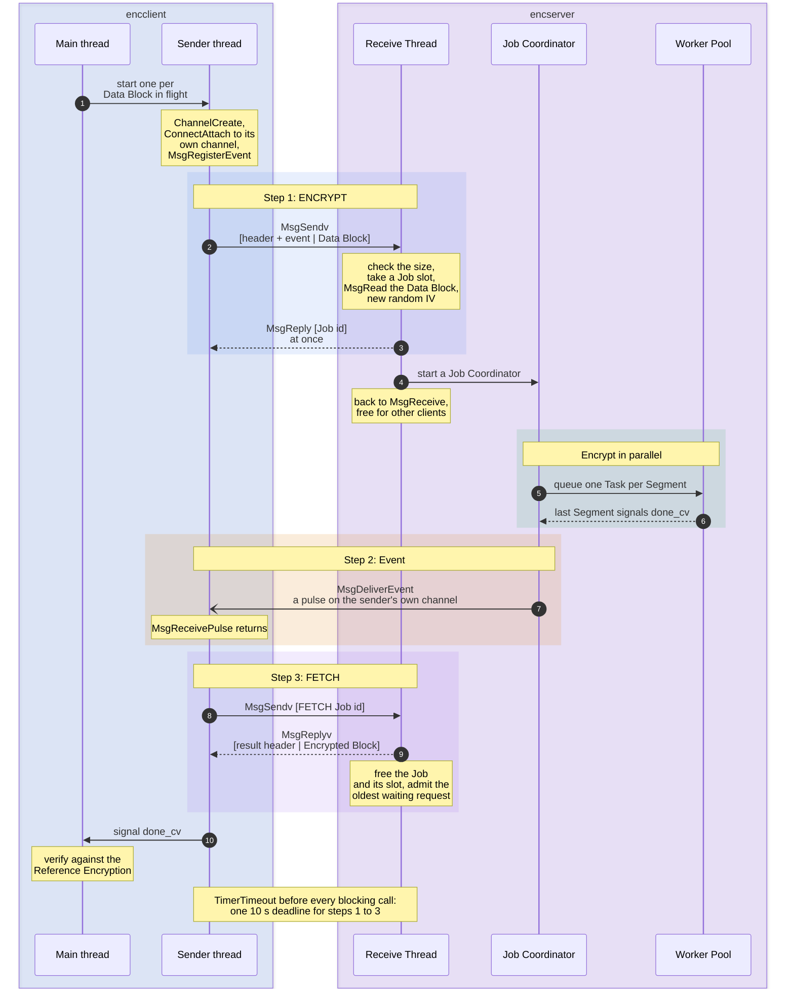

<details>
<summary>Plain-text version of this diagram</summary>

```
 encclient (sender thread)                          encserver
        │  1. ENCRYPT  MsgSendv [header+event | Data Block]
        ├──────────────────────────────────────────────►  Receive Thread: MsgRead, new Job
        │◄──────────────────────────────────────────────  MsgReply [Job id]   (at once)
        │                                                  Job Coordinator + Worker Pool encrypt
        │  2. Event  (pulse on the client's own channel)
        │◄ ─ ─ ─ ─ ─ ─ ─ ─ ─ ─ ─ ─ ─ ─ ─ ─ ─ ─ ─ ─ ─ ─ ─  MsgDeliverEvent (Job Coordinator)
        │  3. FETCH  MsgSendv [Job id]
        ├──────────────────────────────────────────────►  Receive Thread: find the Job
        │◄──────────────────────────────────────────────  MsgReplyv [result header, Encrypted Block]
        │     10 s deadline: TimerTimeout on every blocking call
```

</details>

- The server starts, loads `enc.key`, runs the cipher self-test, starts N workers, and registers `encsvc` with `name_attach`.
- The client loads the same `enc.key` and connects with `name_open("encsvc")`.
- Each sender thread creates its own channel and registers a pulse event for it with `MsgRegisterEvent`.
- The sender thread calls `MsgSendv([header + event | Data Block])` and becomes reply-blocked. The client's main thread keeps running.
- The Receive Thread checks the size and finds a free Job slot, or queues the request. Waiting requests keep their client reply-blocked.
- With a slot, the Receive Thread pulls the Data Block with `MsgRead`, creates the Job with a fresh IV and replies at once with the Job id. It starts a Job Coordinator and returns to `MsgReceive`.
- The Coordinator splits the Data Block into Segments and queues one Task per Segment.
- Workers encrypt their Segments in parallel, each in private memory.
- Each worker locks `job.mutex`, copies its Segment into the Encrypted Block, increments the counter, and unlocks.
- The worker that completes the last Segment signals `job.done_cv`, and the Coordinator wakes.
- The Coordinator marks the Job done and calls `MsgDeliverEvent` with the client's registered pulse.
- The pulse arrives on the sender thread's private channel, and `MsgReceivePulse` returns.
- The sender thread sends FETCH. The Receive Thread finds the Job and calls `MsgReplyv([result header, Encrypted Block])`, and the kernel copies the data into the client's buffers.
- The server frees the Job and its slot, and admits the oldest waiting request. The workers stay alive for the next Job.
- The sender thread signals the main thread's condition variable, which verifies the result against the Reference Encryption and by decrypting it.
- If no Encrypted Block arrives within 10 s, `TimerTimeout` unblocks the call and the client reports `no Encrypted Block within 10 s`.
- If a client dies, the server gets a disconnect pulse and frees everything that client left behind.

**When things go wrong.** The kernel tells the server about both cases with a pulse on its channel:

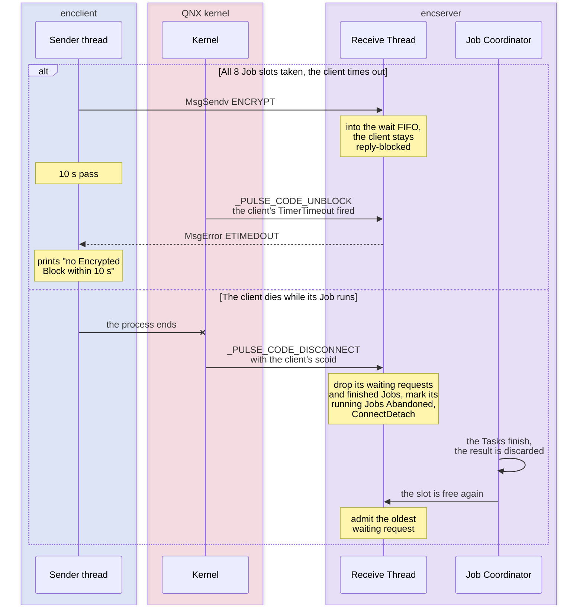

---

## 6. Verification

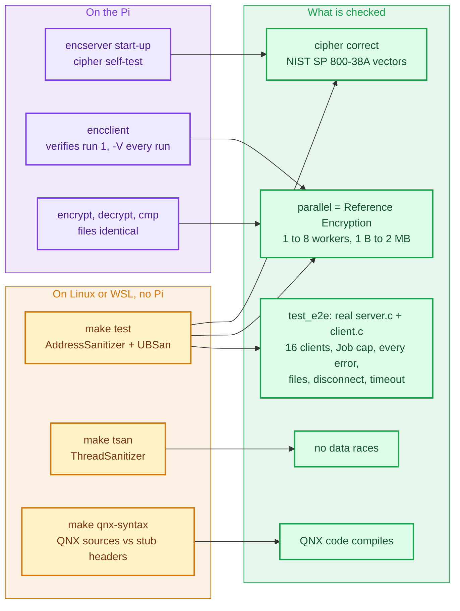

| What | How |
|---|---|
| Cipher correct | NIST SP 800-38A F.5.5 vectors, run at server start-up and in `make test`. The OpenSSL and bundled backends must produce byte-identical output. |
| Parallel = serial | Every Job in the tests is compared with the Reference Encryption, across 1–8 workers and sizes from 1 B to 2 MB. |
| No data races | `make tsan` runs every test under ThreadSanitizer. |
| Server logic | `test_e2e` runs the real `server.c` and `client.c` together on an in-process message-passing stand-in. It covers 16 clients at once, the Job cap, and every error reply. |
| FETCH on the wrong connection | The Job is invisible to another connection: `ENOENT`. The sending connection can fetch it once, and a second FETCH finds nothing. |
| Disconnect frees Jobs | A client that leaves with 3 unfetched Jobs: the server drops them, and all 8 Job slots are free again. |
| Slot limit and unblock pulse | With all 8 slots taken, a 9th ENCRYPT waits. When the client's `TimerTimeout` expires, the server gets `_PULSE_CODE_UNBLOCK` and answers `ETIMEDOUT`. |
| Files | `test_e2e` encrypts and decrypts files through the real client: empty, 1 byte, exactly one Data Block, 3 Data Blocks with 1 and with 8 in flight. It checks the readable header, that `-d` never overwrites a file, and that it rejects plain and cut-short files. |
| Return-value policy | Every API return value is checked (`src/core/sync.h`): pthread calls that fail only through a programming error abort with the name of the call, and the rest are handled by the caller. Only plain terminal printing is unchecked. |
| QNX sources compile | `make qnx-syntax` compiles `server.c`, `client.c`, `client_msg.c` and `client_file.c` against stub QNX headers. `make test`, `make tsan` and `make qnx-syntax` all pass. |
| On the Pi | `encclient` always verifies run 1, and with `-V` it verifies every run. |

---

## 7. Benchmark

- **Encryption Time**: measured by the server, from the first Task queued to the last Task finished. It is returned in the FETCH reply.
- **Round-Trip Time**: measured by the client, from just before the ENCRYPT `MsgSendv` to the end of the FETCH reply. It includes both message copies, the Job id reply, the event, and the FETCH exchange, so it is a little longer than it was with a single reply. Encryption Time is unchanged.

Where the two times start and stop. Encryption Time is the inner, green part:

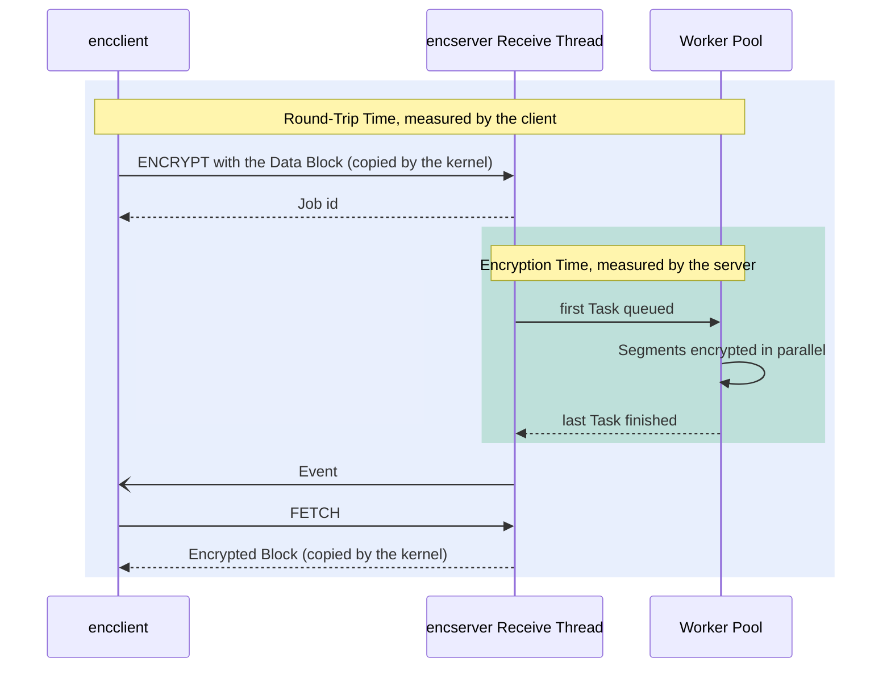

How the benchmark runs, in `bench.sh` and in step 9 of the dashboard:

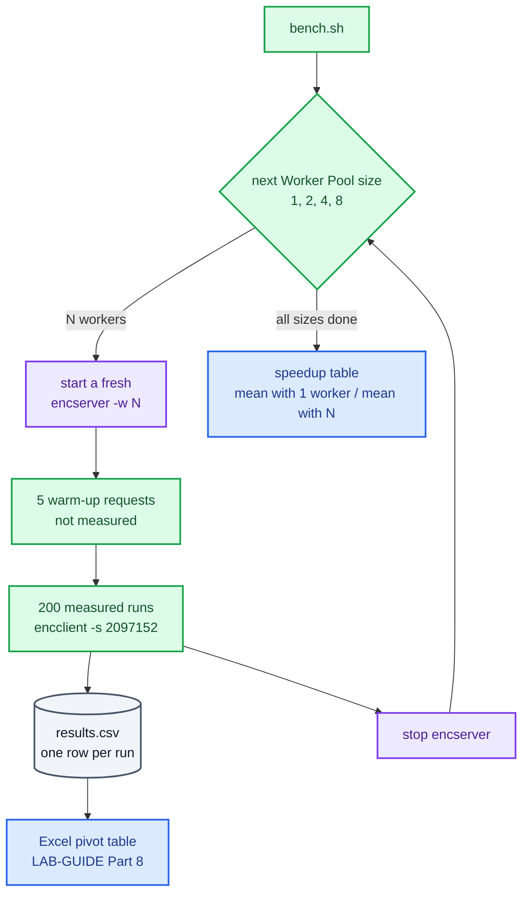

`scripts/bench.sh` runs 1, 2, 4 and 8 workers, with 5 warm-up runs and 200 measured runs each, and writes `results.csv`. On the Pi 4B the bundled AES runs at roughly 10 MB/s per core (measured: a 2 MB Data Block in about 50 ms on 4 workers). So a 2 MB Data Block takes around 200 ms on one worker, much longer than the threading overhead, and the speedup up to 4 workers should be clear. The 8-worker run shows what happens with more workers than cores.

To benchmark larger Data Blocks later, raise `ENC_MAX_BLOCK` in `src/core/config.h` and rebuild.

---

## 8. Files

The server never sees files. A file is only a sequence of Data Blocks, so everything above applies to each of them unchanged.

**Encrypting (`encclient -e`):**

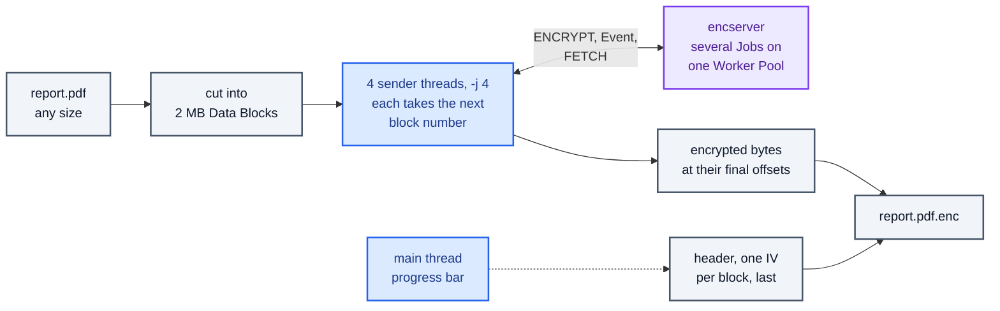

<details>
<summary>Plain-text version of this diagram</summary>

```
file ──split──► Data Block 1   Data Block 2   ...   Data Block n      (2 MB each, last one shorter)
                     │              │                    │
          sender threads (-j, default 4): each takes the next Data Block,
          ENCRYPT, waits for the event, FETCH, then writes its Encrypted Block into place
                     │              │                    │
Encrypted File:  [ readable header with one IV per block | encrypted bytes, same length as the file ]
```

</details>

- Several Data Blocks are in flight at once, so the server runs several Jobs together on one Worker Pool. With 4 in flight on 4 cores every Job keeps the workers busy.
- Each sender thread has its own private channel and pulse, so it receives only the events for its own Data Blocks. `-j` goes up to `ENC_MAX_JOBS` (8).
- Each sender thread takes the next block number under a mutex. The main thread waits on a condition variable and redraws the progress bar each time a block comes back.
- Every Data Block gets its own random IV from the server. The IVs are known only after the replies, so the client writes the encrypted bytes first, at their final offsets, and the header last. The header's length does not depend on the IV values, so the offsets are known from the start.

**The Encrypted File** is meant to be read by people too (`head -n 6 hello.txt.enc`):

```
QNX-ENC v1
name    hello.txt
size    397 bytes
blocks  1 of up to 2097152 bytes
iv 1    02d96ed12ec2d1706ebe75bc5a27fc23
---
<encrypted bytes: exactly 397 of them>
```

**Decrypting (`encclient -d`)** runs on the client with the shared key, one Data Block at a time: CTR decryption is the same operation as encryption. It never overwrites an existing file, and it rejects a file without the header or one that is shorter than its header says. There is no integrity check, so a wrong key or a changed byte gives wrong output. See [ADR 0002](adr/0002-encrypted-file-without-integrity-check.md).

**Live server log (`encserver -v`):** one line when a Job arrives and one when it is done, and `waiting for a free Job slot` when a request has to queue. The done line shows how many Segments each worker encrypted. A worker knows its own index through a thread-local variable set when the pool starts it (`pool_current_worker()`), and `commit_segment` counts per worker under the Job mutex it already holds.

**Source files:**

| File | What it holds |
|---|---|
| `src/qnx/protocol.h` | The messages (ENCRYPT, FETCH), the pulse code, and the error codes |
| `src/qnx/server.c` | `encserver`: Receive Thread, Job slots and the wait FIFO, Job Coordinator, FETCH, disconnect and unblock handling |
| `src/qnx/client_msg.c` | Client side of the protocol: private channel, `MsgRegisterEvent`, ENCRYPT, `MsgReceivePulse`, FETCH, the 10 s `TimerTimeout` |
| `src/qnx/client.c`, `src/qnx/client_file.c` | `encclient`: options, benchmark mode, file encryption and decryption |
| `src/core/sync.c`, `src/core/sync.h` | Checked pthread wrappers (`enc_lock`, `enc_cond_wait`, …) |
| `src/core/job.c`, `worker_pool.c`, `segment.c` | Job, Tasks, Worker Pool, Segment planning |
| `src/core/cipher_*.c`, `aes256.c` | AES-256-CTR, with OpenSSL or the bundled AES |
| `docs/adr/0003-event-notification.md` | Why the Encrypted Block is announced with an event and then fetched (supersedes ADR 0001) |

---

## 9. QNX kernel primitives used

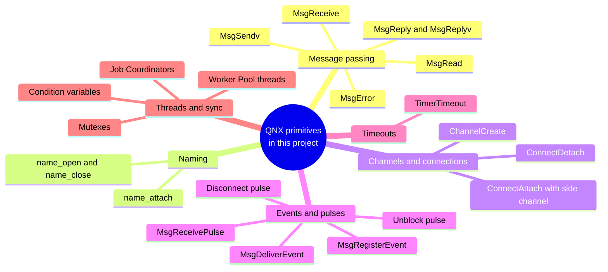

| Primitive | What it does here | Where |
|---|---|---|
| `MsgSendv`, `MsgReceive`, `MsgReply` | Message passing. The client sends ENCRYPT and FETCH with `MsgSendv`; the Receive Thread receives with `MsgReceive` and answers ENCRYPT with `MsgReply` (the Job id). | `client_msg.c` `encsvc_encrypt`; `server.c` `receive_loop`, `admit` |
| `MsgRead` | The server pulls the Data Block out of the client's send buffer, after the header. | `server.c` `admit` |
| `MsgReplyv`, `iov_t` (`SETIOV`) | FETCH is answered from two buffers at once, `[result header, Encrypted Block]`, with no extra copy. The client also sends `[header, Data Block]` and receives into two buffers. | `server.c` `handle_fetch`; `client_msg.c` |
| `MsgError` | Returns an error code (`EINVAL`, `EBUSY`, `ETIMEDOUT`, …) as the result of the client's `MsgSend`. | `server.c` `reply_error` |
| `name_attach`, `name_open`, `name_close` | The server registers `encsvc`; the client finds it by name and gets its connection. | `server.c` `main`; `client.c` `main` |
| `ChannelCreate`, `ChannelDestroy`, `ConnectAttach`, `ConnectDetach` | Each client sender thread has its own channel, and a connection to it (`_NTO_SIDE_CHANNEL`) for the pulse to travel on. The server detaches a client's connection when it disconnects. | `client_msg.c` `encsvc_notify_open`, `encsvc_notify_close`; `server.c` `handle_disconnect` |
| Pulses: `SIGEV_PULSE_INIT`, `MsgRegisterEvent`, `MsgUnregisterEvent` | The client builds its "Job done" Event as a pulse and registers it with the server connection, so the server may deliver it. | `client_msg.c` `encsvc_notify_open`, `encsvc_notify_close` |
| `MsgDeliverEvent` | The Job Coordinator sends the client's Event when the Job is done. | `server.c` `finish_job` |
| `MsgReceivePulse` | The sender thread waits for the Event on its own channel. | `client_msg.c` `wait_for_done` |
| `TimerTimeout` (`SIGEV_UNBLOCK_INIT`, `_NTO_TIMEOUT_SEND`, `_REPLY`, `_RECEIVE`) | Kernel timeout for the next blocking call: the 10 s deadline for ENCRYPT, the wait for the pulse, and FETCH. | `client_msg.c` `arm_timeout` |
| `_PULSE_CODE_DISCONNECT`, `_PULSE_CODE_UNBLOCK` | The server's channel receives a pulse when a client disconnects or dies, and when a client's timeout expires while it is reply-blocked on a waiting request. | `server.c` `receive_loop`, `handle_disconnect`, `handle_unblock` |
| POSIX threads | Worker Pool, one Job Coordinator per Job (detached), client sender threads. | `worker_pool.c`, `server.c` `start_coordinator`, `client.c`, `client_file.c` |
| Mutexes | `job.mutex` (output and counter), `queue_mutex` (Worker Pool queue), `jobs_mutex` (Job table, slots, wait FIFO), `log_mutex` (whole log lines), and the client's own. | `job.c`, `worker_pool.c`, `server.c`, `client.c`, `client_file.c` |
| Condition variables | `done_cv` (all Segments done), `not_empty_cv` (work queued), the client's `done_cv` and `progress_cv`. | `job.c`, `worker_pool.c`, `client.c`, `client_file.c` |
