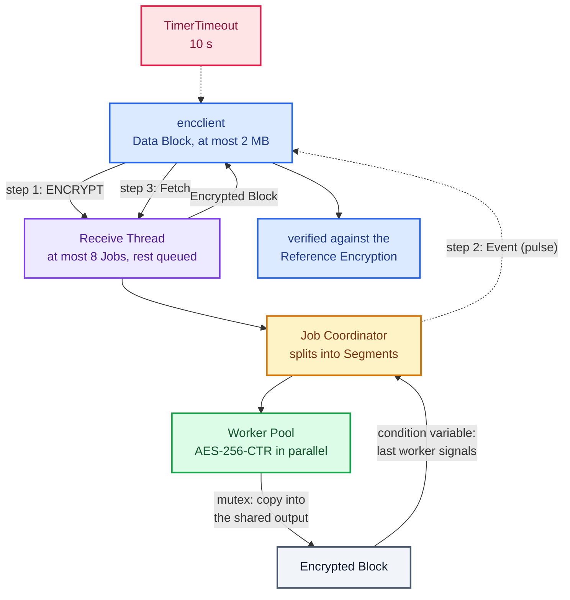
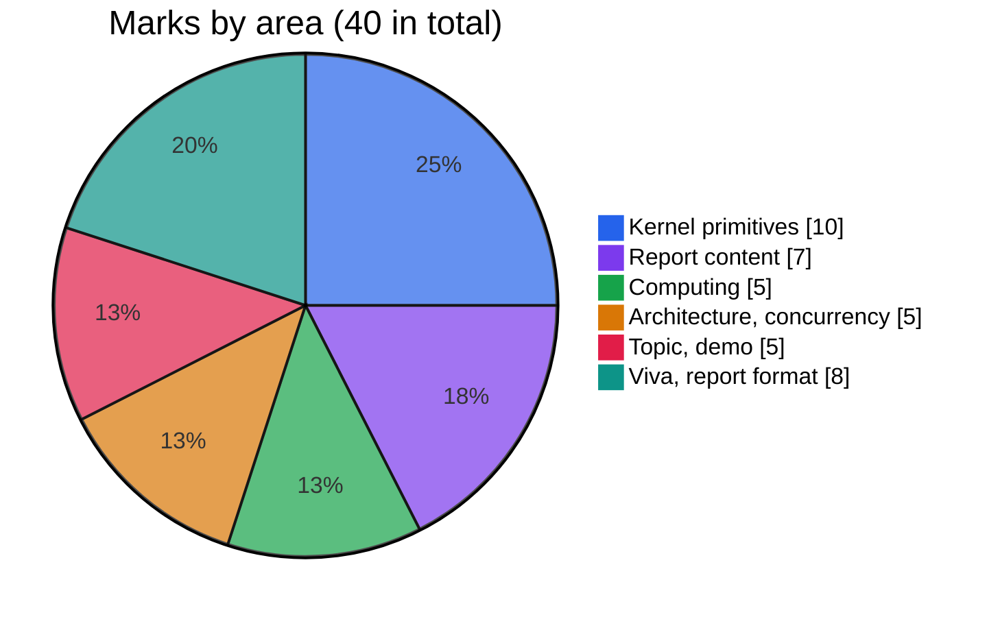
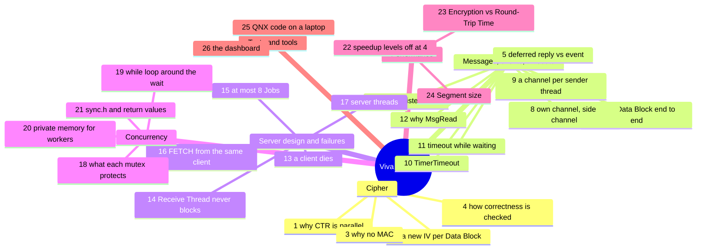

# Viva Notes

A preparation sheet for the team. Every answer here matches the code in this repository. If you change the code, check the answer again. Terms in bold are in [CONTEXT.md](../CONTEXT.md); the full design is in [DESIGN.md](DESIGN.md).

---

## 1. The project in 60 seconds

- `encserver` is a QNX server on a Raspberry Pi 4B. `encclient` sends it a **Data Block** (at most 2 MB), or a whole file cut into Data Blocks.
- The server cuts each Data Block into **Segments** and encrypts them in parallel on a **Worker Pool**, with AES-256-CTR. CTR makes this possible, because every Segment can start at its own counter.
- Workers copy their Segment into one shared output buffer under a **mutex**. The last worker signals a **condition variable**, and the **Job Coordinator** wakes up.
- The server then tells the client with an **Event**, a QNX pulse. The client sends a **Fetch** and gets the **Encrypted Block**. The client waits at most 10 s, using `TimerTimeout`.
- Several clients, and several Data Blocks from one client, run at the same time. The server holds at most 8 **Jobs**, queues the rest, and cleans up after clients that die.
- The client checks every result against a single-threaded **Reference Encryption** and by decrypting it. `bench.sh` shows the speedup for 1, 2, 4 and 8 workers.

The same 60 seconds as one picture:

---

## 2. Rubric and evidence

Where the 40 marks are. Kernel primitives and the report together are half of them:

| Criterion | Marks | What to show or say | Where to point |
|---|---|---|---|
| **RTOS / kernel primitives** | 10 (at least four constructs, 2.5 each) | Name more than four, and show each one in code and in the server log. The strongest four: message passing, pulses and events, `TimerTimeout`, `name_attach` / `name_open`. Then channels, disconnect and unblock pulses, mutexes, condition variables. A table of all of them is in DESIGN.md section 9. | Message passing: `src/qnx/server.c` `admit` (`MsgRead`, `MsgReply`), `handle_fetch` (`MsgReplyv`); `src/qnx/client_msg.c` `encsvc_encrypt` (`MsgSendv`). Pulses and events: `client_msg.c` `encsvc_notify_open` (`MsgRegisterEvent`), `wait_for_done` (`MsgReceivePulse`); `server.c` `finish_job` (`MsgDeliverEvent`). Timeout: `client_msg.c` `arm_timeout` (`TimerTimeout`). Naming: `server.c` `main` (`name_attach`), `client.c` `main` (`name_open`). Disconnect and unblock: `server.c` `handle_disconnect`, `handle_unblock`. Mutex and condition variable: `src/core/job.c` `commit_segment`, `job_run`; `src/core/worker_pool.c` `worker_loop`. |
| **System application and design: topic** | 2.5 | A concurrent encryption service is a real use of an RTOS: many clients, bounded memory, timeouts, clean-up when a client dies. One sentence on why QNX: message passing, pulses and kernel timeouts fit a server like this. | DESIGN.md section 1 (architecture) and section 2 (key decisions) |
| **System application and design: demonstration** | 2.5 | Two SSH windows: `./encserver -v` on the left, `./demo.sh` on the right. Point at the `w0 … w3` columns (parallel Segments), several `→ received` lines before the first `✔` (Jobs overlap), three clients with different pids, and the speedup table in step 5. Or the dashboard: the same output in its two console windows, and the charts on its Analytics tab. | [BEGINNER-GUIDE.md](BEGINNER-GUIDE.md), "Showing the project"; [LAB-GUIDE.md](LAB-GUIDE.md) Part 7; `scripts/demo.sh`; [dashboard/README.md](../dashboard/README.md) |
| **Implementation: computing** | 5 | AES-256-CTR works in parallel and gives the same bytes as the single-threaded version. Two checks: the NIST test vectors at server start-up, and the client's Reference Encryption comparison on every file and benchmark run. | `src/core/cipher_common.c` `cipher_self_test`, `cipher_counter_at`; `src/core/cipher_openssl.c` and `cipher_builtin.c`; `src/core/segment.c`; `src/qnx/client.c` `verify` |
| **Implementation: architecture** | 2.5 | Three layers: portable core (`src/core`), QNX message passing (`src/qnx`), tests with a message-passing stand-in. Thread roles: Receive Thread, one Job Coordinator per Job, Worker Pool. The protocol is one header file. | DESIGN.md section 1; `src/qnx/protocol.h`; `src/qnx/server.c` header comment; `tests/qnx_shim.c` |
| **Implementation: concurrency and synchronisation** | 2.5 | One mutex per shared structure and what it guards. A predicate-guarded condition-variable wait. A server that never blocks its Receive Thread. Races checked with ThreadSanitizer. Every pthread return value checked. | `src/core/job.c` (`job.mutex`, `done_cv`); `src/core/worker_pool.c` (`queue_mutex`, `not_empty_cv`); `src/qnx/server.c` (`jobs_mutex`, `log_mutex`); `src/core/sync.c`; `make tsan` |
| **Understanding (viva): project concepts** | 2.5 | Be able to explain CTR, Segments, the event protocol, slots and the wait queue, client death, and the timeout. | Section 3 of this file |
| **Understanding (viva): comprehension** | 2.5 | Be able to say why each choice was made and what the alternative was, and to read any function in the repo aloud. | ADRs 0001 to 0003 in `docs/adr/`; section 3 of this file |
| **Report: format** | 3 | Short sentences, tables, one glossary, numbered sections, pseudocode that matches the code, decisions with reasons. | [DESIGN.md](DESIGN.md), [CONTEXT.md](../CONTEXT.md), [README.md](../README.md) |
| **Report: technical content** | 7 | Architecture diagram (section 1), key decisions (2), data structures (3), pseudocode (4.1 to 4.6), communication flow (5), verification (6), benchmark (7), kernel primitives (9). The benchmark results come from `results.csv` and the speedup table. | DESIGN.md; `docs/adr/0003-event-notification.md`; `scripts/bench.sh` |

---

## 3. Likely viva questions

The questions by topic, with their numbers, for revision:

### Cipher

**1. Why can CTR mode be parallelised?**
CTR turns AES into a keystream generator. Block *i* of the keystream is `AES(key, IV + i)`, so it does not depend on any other block. A Segment that starts at byte `offset` just starts at counter `IV + offset/16` (`cipher_counter_at`), and Segments can then be encrypted in any order, on any thread. CBC encryption cannot do this, because each block needs the previous ciphertext block.

**2. Why is the IV new for every Data Block?**
With the same key and IV, CTR gives the same keystream. XOR of two ciphertexts then equals XOR of the two plaintexts, which leaks the data. The server draws 16 random bytes from `/dev/urandom` for every Job (`admit`), returns them in the FETCH reply, and the Encrypted File header stores one IV per Data Block.

**3. Why is there no MAC?**
It is a choice, recorded in [ADR 0002](adr/0002-encrypted-file-without-integrity-check.md). The project is about concurrency, and a MAC would add a second crypto construction and a second protocol path. The cost: a wrong key or a changed byte is not detected, because AES-CTR gives confidentiality but not integrity. A real product would add HMAC-SHA256 or AES-CMAC over the header and the encrypted bytes. The header does still catch a file that is not an Encrypted File or is cut short.

**4. How do you know the parallel result is correct?**
Three ways. The NIST SP 800-38A F.5.5 vectors run at server start-up (`cipher_self_test`). Every Job in `make test` is compared with the Reference Encryption, for 1 to 8 workers and sizes from 1 byte to 2 MB. The client also compares every file and benchmark run 1 (every run with `-V`) with the Reference Encryption, and decrypts the result to get the Data Block back.

### Message passing, events and timeouts

**5. What is a deferred reply, and what is an event-based reply? Which one do you use?**
A deferred reply means the server keeps the client's `rcvid` and calls `MsgReply` only when the work is done. The client stays reply-blocked all that time. We used it first ([ADR 0001](adr/0001-deferred-reply.md)). An event-based reply means the server answers at once and later sends the client a notification. We use this now ([ADR 0003](adr/0003-event-notification.md)): ENCRYPT is answered at once with a Job id, the Job Coordinator calls `MsgDeliverEvent` when the Job is done, and the client sends FETCH to get the Encrypted Block. We switched because the brief asks for an answer through an event.

**6. Walk through one Data Block from start to end.**
The client's sender thread calls `MsgSendv` with `[ENCRYPT header + event | Data Block]`. The Receive Thread reads the header, uses `MsgRead` to pull the Data Block, picks an IV, replies with the Job id, and starts a Job Coordinator. The Coordinator splits the Data Block into Segments and queues Tasks. Workers encrypt. The last worker signals `done_cv`. The Coordinator marks the Job done and calls `MsgDeliverEvent`. The pulse arrives on the sender thread's own channel, `MsgReceivePulse` returns, and the thread sends FETCH. The Receive Thread answers with `MsgReplyv([result header | Encrypted Block])`, frees the Job and admits the next waiting request.

**7. Why `MsgRegisterEvent`?**
The server delivers the client's event, so the server has to be allowed to. `MsgRegisterEvent(&event, server_coid)` stores the event in the kernel and **replaces the client's copy with a handle**; only the server behind `server_coid` may deliver it. The client sends that handle in ENCRYPT, and when the server calls `MsgDeliverEvent` the kernel looks the handle up and delivers the event exactly as registered. This is QNX's "secure events" mechanism. On QNX 8.0 it is not optional: by default the kernel accepts only registered events (`procnto -U` would allow others), so an unregistered pulse would fail with `EACCES`. The code does it in `encsvc_notify_open`. The server never builds or changes an event; it only delivers the handle it was given.

**8. Why does the client `ConnectAttach` to its own channel? What does `_NTO_SIDE_CHANNEL` mean?**
A pulse has to travel on a connection, and a connection is a channel id plus a connection id (`coid`). `name_open` gives a connection to the server only. To receive a pulse, the client creates a channel (`ChannelCreate`) and attaches a connection to it (`ConnectAttach`); the event names that connection. `_NTO_SIDE_CHANNEL` makes the kernel allocate the `coid` from a separate range, away from the file descriptor numbers, so this internal connection does not use up or clash with a file descriptor. We add `_NTO_COF_CLOEXEC` so it is closed on `exec`. This is the client's only `ConnectAttach`.

**9. Why does each sender thread have its own channel?**
So that each thread receives only its own pulses with `MsgReceivePulse`, with no dispatcher thread and no lookup from a pulse to a request. The pulse needs no value: its code is `ENCSVC_PULSE_DONE`, and the channel is the thread's own. If a late pulse from an earlier Data Block wakes the thread, FETCH answers `EAGAIN` and the thread waits again. An alternative was one channel per process with a dispatcher thread (ADR 0003); we rejected it as more code for no gain.

**10. What does `TimerTimeout` apply to?**
Only to the next blocking kernel call of the calling thread, and only for the states you list. `MsgSendv` is covered by `_NTO_TIMEOUT_SEND | _NTO_TIMEOUT_REPLY`, `MsgReceivePulse` by `_NTO_TIMEOUT_RECEIVE`. When the time runs out, the kernel unblocks the call and it fails with `ETIMEDOUT`. It is one-shot, so `arm_timeout` calls it again before each of the three blocking calls, with the time left until one deadline of 10 s (`ENC_CLIENT_TIMEOUT_NS`) for the whole exchange. The client then prints `no Encrypted Block within 10 s`.

**11. A client times out while its request waits for a Job slot. What does the server see?**
The server's channel is created by `name_attach` with the unblock flag, so when the client's timeout fires, the kernel does not just unblock the client. It sends the server a `_PULSE_CODE_UNBLOCK` pulse first, and the client stays blocked until the server replies. `handle_unblock` finds the request in the wait FIFO, removes it and answers `ETIMEDOUT`. `test_waiting_request_times_out` in `tests/test_e2e.c` checks this. If the request is not waiting, it is being answered at that moment, which unblocks the client anyway. The flip side: a client that is reply-blocked on a server that is frozen (for example stopped with `SIGSTOP`) stays blocked until the server runs again, because only the server can answer. That is short here: the long wait, for the pulse, is a `MsgReceivePulse` on the client's own channel, and that times out normally.

**12. Why does the server read the Data Block with `MsgRead` instead of receiving it?**
The `MsgReceive` buffer holds only the small header. The server checks the header (size 1 byte to 2 MB), and only then allocates a buffer and pulls the Data Block out of the client's send buffer at offset `sizeof(header)`. No receive buffer has to be as large as the largest Data Block, and a bad request is rejected before any large allocation. The reply side does the same in reverse: `MsgReplyv` sends `[result header | Encrypted Block]` from two buffers with no extra copy.

### Server design and failure handling

**13. What happens when a client dies?**
The kernel sends the server a `_PULSE_CODE_DISCONNECT` pulse with the client's `scoid`. `handle_disconnect` removes that client's waiting requests, frees its finished Jobs that were never fetched, and marks its running Jobs Abandoned. Their Job Coordinators free them when the Tasks finish, and log `client gone, Encrypted Block discarded`. The server also calls `ConnectDetach(scoid)` and admits waiting requests into the freed slots. A Job whose `MsgDeliverEvent` fails is treated the same way. `test_disconnect_frees_jobs` checks that all 8 slots come back.

**14. Why does the Receive Thread never block on a Job slot?**
A Job keeps its slot until its Encrypted Block is fetched, and the FETCH arrives as a message at the Receive Thread. If that thread waited for a free slot, it could not receive the FETCH that frees one, and the server would deadlock. So extra ENCRYPT requests go into a FIFO (at most `ENC_MAX_WAITING` = 64, then `EBUSY`), and their clients stay reply-blocked.

**15. Why at most 8 Jobs?**
The server now stores results between the event and the FETCH. Each Job holds a Data Block and an Encrypted Block, so 8 Jobs of 2 MB use about 32 MB at most. The limit bounds memory. A waiting request costs only a small record, because its data stays in the client's buffer until the server calls `MsgRead`.

**16. Why must FETCH come from the same client as ENCRYPT?**
`find_job_locked` matches the Job id and the client's `scoid`. On QNX the `scoid` identifies the client process on the server side (all of a process's connections to the channel share it). A client can therefore not fetch or discard another client's Encrypted Block, and a second FETCH finds nothing (`ENOENT`). `test_fetch_needs_same_connection` checks both.

**17. What threads does the server have?**
The Receive Thread (the main thread, `receive_loop`), one detached Job Coordinator per Job, and the N workers of the Worker Pool. The Coordinator runs the Job and waits for it; it frees the Receive Thread and the workers from doing that waiting.

### Concurrency

**18. What does the mutex protect?**
There is one per shared structure. `job.mutex` protects the Job's `completed_count`, `error`, per-worker Segment counts and finish time, and the copy into the output buffer. `queue_mutex` protects the Worker Pool's queue and its `shutdown` flag. `jobs_mutex` protects the server's Job list, slot count, wait FIFO, and each Job's `done` and `abandoned` flags. `log_mutex` keeps log lines whole. Each worker's copy goes to a different byte range, so it is the counter, the error and the statistics that truly need the lock. Copying inside the lock keeps one simple rule: when the counter reaches the total, all the bytes are in place, and the mutex hand-over makes them visible to the Coordinator.

**19. Why is the condition-variable wait in a `while` loop?**
Two reasons. A wait can return without a signal (a spurious wake-up), so the thread must test its condition again. And the condition can already be true before the thread waits, because the last worker may finish before the Coordinator reaches the wait. With `while (completed < total) wait(...)`, the Coordinator simply does not wait in that case. See `job_run` in `src/core/job.c` and `worker_loop` in `src/core/worker_pool.c`.

**20. Why do workers encrypt into private memory?**
So that the lock is held only for a `memcpy` and a counter increment, not for the encryption. `encrypt_segment` allocates a scratch buffer, encrypts into it with no lock held, then calls `commit_segment`. Workers wait on each other for microseconds, not milliseconds.

**21. What does `sync.h` do, and what is the return-value policy?**
`enc_lock`, `enc_unlock`, `enc_cond_wait` and the others check the pthread return value and, on failure, print which call failed and `abort()`. These calls fail only through a programming error, such as unlocking a mutex the thread does not hold, so stopping at once is better than carrying on with a broken lock. Calls that can fail for ordinary reasons (`pthread_create`, initialisation) are checked by their callers, which recover. Every API return value in the code is checked. Only plain terminal printing is left unchecked.

### Performance

**22. Why does the speedup level off at 4 workers?**
The Pi 4B has 4 cores, so 4 workers can use all of them. With 8 workers, two threads share each core, and the extra context switches cost a little, so the time does not improve. Below 4, the speedup is close to the number of workers, because the work (about 10 MB/s per core for the bundled AES) is much longer than the threading overhead. It stays below 4 times, because copying the Data Block and the message exchange are serial. The benchmark script shows all of this: `./bench.sh`.

**23. What is the difference between Encryption Time and Round-Trip Time?**
Encryption Time is measured on the server, from the first Task queued to the last Task finished. Round-Trip Time is measured on the client, from just before the ENCRYPT `MsgSendv` to the end of the FETCH reply. It includes both message copies, the Job id reply, the event and the FETCH exchange, so it is always larger. Encryption Time did not change when we moved to events; Round-Trip Time got a little longer.

**24. How is the Segment size chosen?**
A Data Block of 64 KB or less is one Segment. Larger ones get `ceil(len / (workers × 4))` bytes per Segment, at least 16 KB, rounded up to a multiple of 16. Four Tasks per worker let a fast worker pick up extra Tasks, which balances the load. A 2 MB Data Block on 4 workers gives 16 Segments of 128 KB.

### Tests

**25. How do you test QNX code on a laptop?**
`tests/qnx_shim.c` is a message-passing stand-in with the same calls (`MsgSend`, `MsgReceive`, pulses, `TimerTimeout`, and so on) built on POSIX threads. `test_e2e` runs the real `server.c` and `client.c` on it: 16 clients at once, the Job cap, every error reply, files, FETCH by the wrong client, a disconnect, and a timeout through the unblock pulse. The stand-in also refuses an event that was not registered, as QNX 8 does. `make test` runs with AddressSanitizer and UBSan, `make tsan` with ThreadSanitizer, and `make qnx-syntax` compile-checks the QNX sources against stub headers. The stand-in does not model priorities or process death: a `name_close` stands in for a client leaving, and a real kill of a client is a manual test on the Pi.

### Dashboard

**26. What is the dashboard, and is it part of the QNX design?**
It is a helper on the PC, not part of the service. A small Python backend (`dashboard/backend`) runs each step over SSH: it copies a short `sh` script to the Pi, runs it on a terminal (`ssh -tt`), and reads what encclient, encserver and `lib.sh` print. The page only draws those numbers. Every number on it comes from the real programs on the Pi; nothing is simulated. The QNX code is the same whether you use the dashboard or type the commands yourself.

---

## 4. Do not say

- "The server cancels the Job when the client dies." It does not. Running Tasks finish and the result is discarded.
- "The data is protected against tampering." It is not. There is no MAC (ADR 0002).
- "The reply is deferred." That was the first version. The server now answers ENCRYPT at once and uses an event.
- "More workers are always faster." Not beyond the 4 cores.
