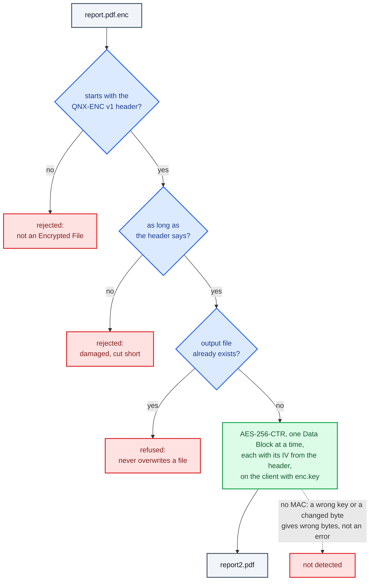

# Encrypted Files have no integrity check and are decrypted on the client

The client turns a file into an Encrypted File by sending it to the server as Data Blocks, and turns it back by decrypting on its own with the shared key. We added no MAC, no key check value, and no DECRYPT message to the server. The project is about concurrency on QNX, not about building a secure file format, and every one of these would add a second protocol path or a second crypto construction to test and explain. Decrypting and then comparing with `cmp` already proves the round trip in the demo.

What `encclient -d` checks, and what it cannot check:

## Consequences

- A wrong key or a changed byte is not detected: decryption simply gives wrong bytes. AES-CTR alone gives confidentiality, not integrity. Adding a MAC (for example HMAC-SHA256 or AES-CMAC over the header and the encrypted bytes) is the first thing to do if this were used for real.
- Decryption runs on one client thread, so it is slower than encryption on the Worker Pool and is not part of the benchmark.
- The header still records the sizes and IVs, so a file that is not an Encrypted File, or one that has been cut short, is rejected before anything is written.
